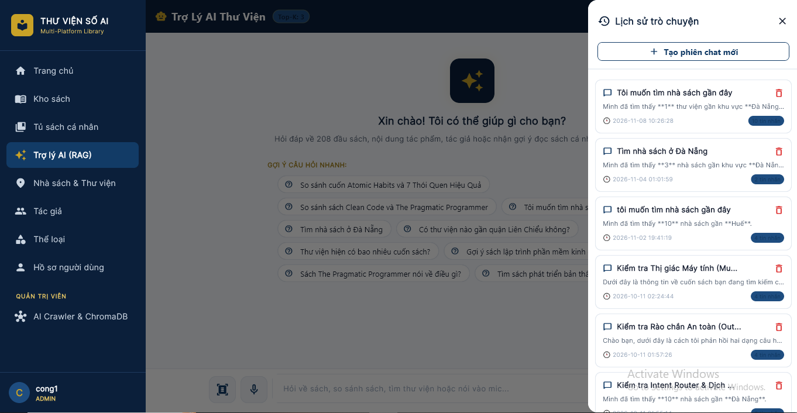
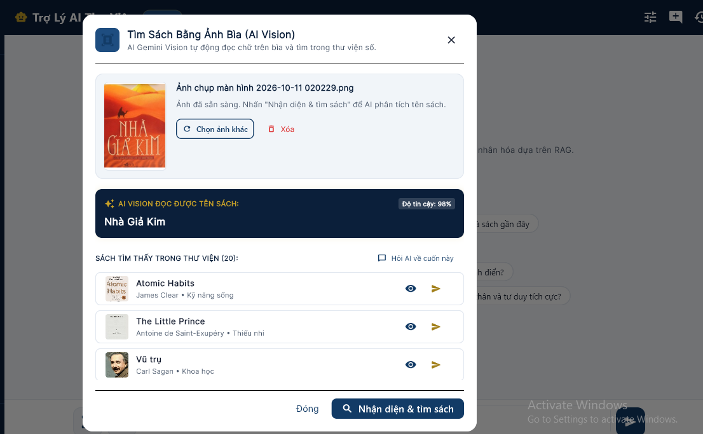
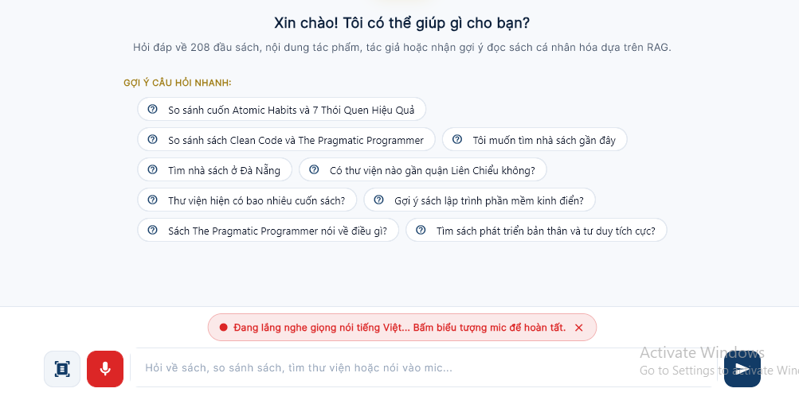
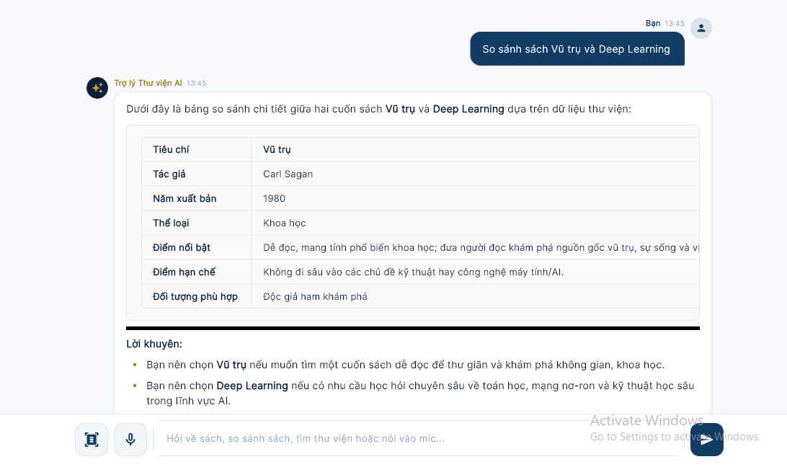
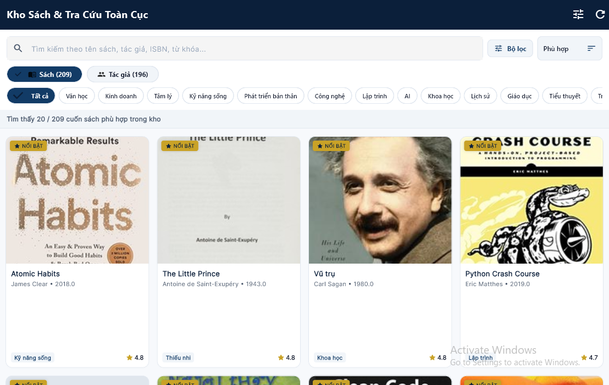
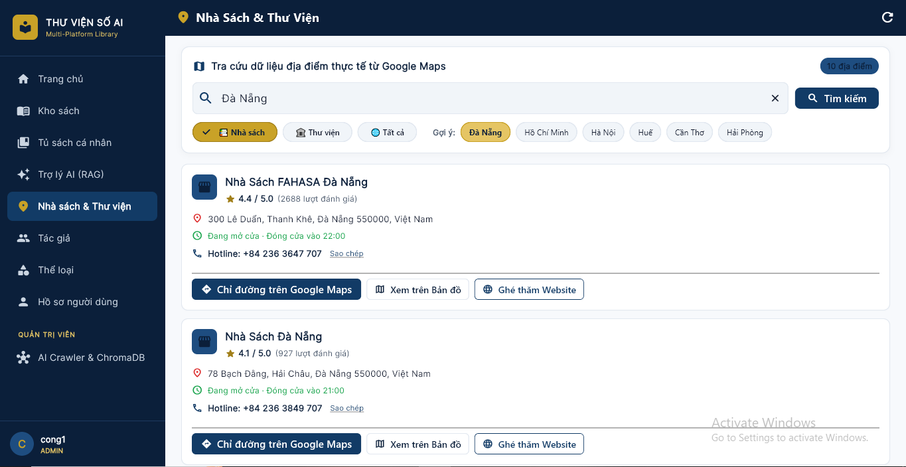
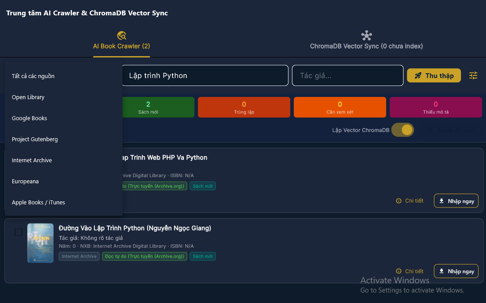
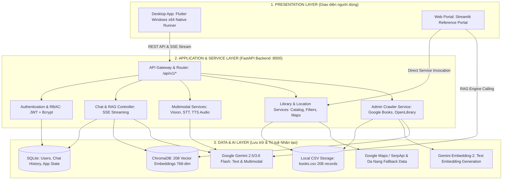

# 📚 AI Digital Library & Multimodal Book Recommender Chatbot

> **Hệ thống Thư viện số và Trợ lý ảo tư vấn, gợi ý sách thông minh Đa phương thức**  
> *Đồ án Trí tuệ Nhân tạo (AIP202) — Khoa Công nghệ Thông tin, Trường Đại học Kiến trúc Đà Nẵng (DAU)*

---

<p align="center">
  
  
  
  
  
  
  
</p>

---

## 📑 Mục lục (Table of Contents)

- [🌟 Giới thiệu tổng quan (Overview)](#-giới-thiệu-tổng-quan-overview)
- [✨ Các tính năng nổi bật (Key Features)](#-các-tính-năng-nổi-bật-key-features)
  - [1. Trợ lý AI RAG & Truyền phát thời gian thực (SSE Streaming)](#1-trợ-lý-ai-rag--truyền-phát-thời-gian-thực-sse-streaming)
  - [2. Quét bìa sách AI Vision (Computer Vision Scanner)](#2-quét-bìa-sách-ai-vision-computer-vision-scanner)
  - [3. Tương tác giọng nói hai chiều (Voice STT & AI TTS Audio Stream)](#3-tương-tác-giọng-nói-hai-chiều-voice-stt--ai-tts-audio-stream)
  - [4. Bảng so sánh sách đa tài liệu (Horizontally Responsive Comparison)](#4-bảng-so-sánh-sách-đa-tài-liệu-horizontally-responsive-comparison)
  - [5. Kho sách số đa tiêu chí & Đọc thử mẫu (Book Catalog)](#5-kho-sách-số-đa-tiêu-chí--đọc-thử-mẫu-book-catalog)
  - [6. Định vị nhà sách & Thư viện thực tế (Location & Map Finder)](#6-định-vị-nhà-sách--thư-viện-thực-tế-location--map-finder)
  - [7. Quản trị AI Crawler & Đồng bộ Vector ChromaDB (Self-Healing Vector Sync)](#7-quản-trị-ai-crawler--đồng-bộ-vector-chromadb-self-healing-vector-sync)
  - [8. Bảo mật JWT & Phân quyền RBAC](#8-bảo-mật-jwt--phân-quyền-rbac)
- [🏛️ Kiến trúc hệ thống (System Architecture)](#️-kiến-trúc-hệ-thống-system-architecture)
  - [Mô hình 3 tầng (Three-Tier Architecture)](#mô-hình-3-tầng-three-tier-architecture)
  - [Luồng xử lý RAG & Multimodal AI](#luồng-xử-lý-rag--multimodal-ai)
  - [Bảng công nghệ sử dụng (Tech Stack)](#bảng-công-nghệ-sử-dụng-tech-stack)
- [🚀 Hướng dẫn cài đặt & Khởi chạy (Installation & Getting Started)](#-hướng-dẫn-cài-đặt--khởi-chạy-installation--getting-started)
  - [Yêu cầu tiên quyết (Prerequisites)](#yêu-cầu-tiên-quyết-prerequisites)
  - [Bước 1: Thiết lập môi trường ảo Python](#bước-1-thiết-lập-môi-trường-ảo-python)
  - [Bước 2: Cài đặt thư viện phụ thuộc](#bước-2-cài-đặt-thư-viện-phụ-thuộc)
  - [Bước 3: Cấu hình biến môi trường (.env)](#bước-3-cấu-hình-biến-môi-trường-env)
  - [Bước 4: Khởi chạy máy chủ Backend (FastAPI)](#bước-4-khởi-chạy-máy-chủ-backend-fastapi)
  - [Bước 5: Khởi chạy ứng dụng Desktop Flutter Windows Release](#bước-5-khởi-chạy-ứng-dụng-desktop-flutter-windows-release)
  - [Bước 6: Khởi chạy Web Portal Streamlit (Tùy chọn)](#bước-6-khởi-chạy-web-portal-streamlit-tùy-chọn)
  - [Bước 7: Chạy bộ kiểm thử tự động (Automated Tests)](#bước-7-chạy-bộ-kiểm-thử-tự-động-automated-tests)
- [📁 Cấu trúc thư mục dự án (Project Directory Structure)](#-cấu-trúc-thư-mục-dự-án-project-directory-structure)
- [📊 Kết quả kiểm thử & Đánh giá (Verification & Quality Metrics)](#-kết-quả-kiểm-thử--đánh-giá-verification--quality-metrics)
- [👨‍🎓 Thông tin tác giả & Báo cáo đồ án (Author & Academic Docs)](#-thông-tin-tác-giả--báo-cáo-đồ-án-author--academic-docs)
- [📄 Giấy phép (License)](#-giấy-phép-license)

---

## 🌟 Giới thiệu tổng quan (Overview)

Trong kỷ nguyên bùng nổ thông tin và chuyển đổi số giáo dục, các hệ thống thư viện truyền thống dựa vào tra cứu từ khóa chính xác (`lexical search`) thường bộc lộ hạn chế rõ rệt khi người dùng diễn đạt nhu cầu bằng ngôn ngữ tự nhiên phức tạp hoặc đa dạng ngữ cảnh (tâm trạng, trình độ, độ tuổi, mục tiêu học tập). Ngược lại, các Mô hình Ngôn ngữ Lớn (LLMs) tạo sinh tuy có khả năng đối thoại linh hoạt nhưng lại thường mắc lỗi **"ảo giác" (hallucination)** và thiếu tri thức chuyên sâu về kho dữ liệu sách cục bộ có thực của thư viện.

**AI Digital Library & Multimodal Book Recommender Chatbot** là một giải pháp toàn diện kết hợp:
1. **Kiến trúc RAG (Retrieval-Augmented Generation)**: Neo giữ tri thức trong cơ sở dữ liệu vector ngữ nghĩa **ChromaDB** với độ đo khoảng cách Cosine Distance, trích xuất top-K ấn phẩm sát nhất để cung cấp làm ngữ cảnh cho mô hình tạo sinh **Google Gemini 2.5 / 3.6 Flash**.
2. **Tương tác Đa phương thức (Multimodal Interaction)**: Hỗ trợ đầu vào qua **Văn bản**, **Hình ảnh bìa sách (Computer Vision)** và **Giọng nói (Speech-to-Text)**; đầu ra qua **Văn bản trực quan**, **Bảng so sánh Markdown** và **Giọng đọc truyền phát thời gian thực (Audio TTS Stream)**.
3. **Đa nền tảng & Hiệu năng cao**: Backend bất đồng bộ xây dựng bằng **FastAPI**, cung cấp hơn 25 RESTful endpoints và luồng truyền phát **Server-Sent Events (SSE)**. Giao diện người dùng hiện đại, đồng bộ tính năng 100% giữa ứng dụng **Desktop Flutter Native C++ Runner (Windows x64)** và cổng thông tin Web **Streamlit**.

---

## ✨ Các tính năng nổi bật (Key Features)

### 1. Trợ lý AI RAG & Truyền phát thời gian thực (SSE Streaming)
- Đàm thoại thông minh đa lượt (multi-turn conversation) có lưu ngữ cảnh lịch sử cho từng tài khoản người dùng riêng biệt.
- Cơ chế truyền phát phản hồi **Server-Sent Events (SSE)** với thời gian trễ nhận từ đầu tiên (**Time-To-First-Token - TTFT**) trung bình dưới **1.2 giây**.
- **Grounding & Chống ảo giác**: Trợ lý chỉ gợi ý những đầu sách thực sự tồn tại trong kho dữ liệu chuẩn hóa (208 đầu sách), đính kèm minh bạch danh sách nguồn tham khảo (`Grounding Sources`) cùng độ tương đồng ngữ nghĩa.


*(Hình 1: Giao diện Trợ lý ảo AI đàm thoại thông minh với luồng phản hồi streaming và trích dẫn nguồn sách)*

---

### 2. Quét bìa sách AI Vision (Computer Vision Scanner)
- Tích hợp trực tiếp **Gemini Multimodal Vision API** cho phép phân tích ảnh bìa sách chụp từ Camera hoặc tải lên từ tệp tin cục bộ (`.jpg`, `.jpeg`, `.png`).
- Tự động bóc tách tên sách, tác giả, nhà xuất bản và đối chiếu ngay lập tức với kho sách nội bộ để hiển thị hồ sơ thông tin chi tiết hoặc gợi ý tác phẩm tương tự nếu chưa có trong kho.
- Kiểm tra an toàn tệp tải lên theo magic bytes trên bộ nhớ RAM, giới hạn dung lượng tối đa 8 MB.


*(Hình 2: Tính năng quét ảnh bìa sách thông minh qua Computer Vision và tự động truy xuất dữ liệu)*

---

### 3. Tương tác giọng nói hai chiều (Voice STT & AI TTS Audio Stream)
- **Speech-to-Text (STT)**: Chuyển đổi giọng nói tiếng Việt thành văn bản tức thì thông qua luồng âm thanh đa phương thức của Gemini, hỗ trợ người khiếm thị hoặc người thích ra lệnh bằng giọng nói.
- **Text-to-Speech (TTS Audio Streaming)**: Tự động loại bỏ các định dạng Markdown/GFM phức tạp, chuyển đổi câu trả lời của AI thành luồng âm thanh định dạng `.mp3` chất lượng cao, phát trực tiếp trên thanh điều khiển âm thanh nổi (`Floating Audio Player Bar`). Giải quyết dứt điểm hạn chế thiếu giọng đọc tiếng Việt SAPI mặc định trên Windows.


*(Hình 3: Giao diện thu âm giọng nói STT và trình phát thanh âm thanh thông minh TTS)*

---

### 4. Bảng so sánh sách đa tài liệu (Horizontally Responsive Comparison)
- Khi người dùng yêu cầu so sánh nhiều ấn phẩm (ví dụ: *"So sánh sách Đắc nhân tâm và Nghệ thuật giao tiếp"*), AI tự động tổng hợp bảng Markdown chuẩn GFM đa tiêu chí: Tác giả, Thể loại, Đối tượng độc giả, Độ khó, Điểm mạnh và Giá trị cốt lõi.
- Giao diện Desktop tích hợp bộ render bảng cuộn ngang mượt mà (`SingleChildScrollView`), chống tràn viền màn hình (overflow) ngay cả khi bảng có nhiều cột chi tiết.


*(Hình 4: Khối bảng Markdown so sánh đa sách cuộn ngang linh hoạt trên Flutter Desktop)*

---

### 5. Kho sách số đa tiêu chí & Đọc thử mẫu (Book Catalog)
- Quản lý và tra cứu danh mục **208 đầu sách tiếng Việt** chất lượng cao với bộ lọc đa chiều:
  - Thể loại (Genres), Tác giả (Authors), Năm xuất bản.
  - Điểm đánh giá (Rating), Độ khó đọc (Beginner, Intermediate, Advanced).
  - Tâm trạng đọc (Mood: Truyền cảm hứng, Suy ngẫm, Hồi hộp, Thư giãn...).
- Hỗ trợ chính sách đọc thử mẫu hợp pháp: Mở trực tiếp trình đọc PDF tích hợp hoặc tải EPUB an toàn đối với các đầu sách được gắn nhãn `reading_available=true`.


*(Hình 5: Màn hình Kho sách số với bộ lọc đa tiêu chí và danh sách thẻ sách trực quan)*

---

### 6. Định vị nhà sách & Thư viện thực tế (Location & Map Finder)
- **Intent Router chuyên biệt**: Nhận diện tức thì ý định tìm kiếm địa điểm ngoại đời thực thông qua từ khóa ngắn hoặc dài (*"nhà sách", "thư viện", "mua sách ở đâu", "tìm hiệu sách gần đây"*).
- Tích hợp **Google Maps Search API / SerpApi** cùng cơ chế dự phòng định tuyến tĩnh (**Fallback thông minh tại Đà Nẵng**), hiển thị danh sách các nhà sách lớn (Fahasa, Phương Nam...) và Thư viện Khoa học Tổng hợp Đà Nẵng kèm địa chỉ, giờ mở cửa, số điện thoại và nút mở chỉ đường Google Maps bằng một cú nhấp chuột.


*(Hình 6: Bản đồ định vị và danh sách nhà sách/thư viện thực tế kèm nút dẫn đường Google Maps)*

---

### 7. Quản trị AI Crawler & Đồng bộ Vector ChromaDB (Self-Healing Vector Sync)
- **Bảng quản trị AI Crawler**: Cho phép thủ thư và Quản trị viên (Admin) tìm kiếm sách trực tuyến từ các nguồn thư viện mở quốc tế (Google Books, OpenLibrary, Apple Books), xem trước bìa sách và metadata, phát hiện trùng lặp tự động và nhập vào hệ thống chỉ với một thao tác.
- **Tự chữa lành đồng bộ dữ liệu (ChromaDB Vector Sync)**: Quét và phát hiện các đầu sách trong cơ sở dữ liệu chưa được nhúng vector, tự động tạo embedding 768 chiều và nạp bổ sung vào ChromaDB mà không làm gián đoạn hay phá hủy dữ liệu vector hiện hữu (đảm bảo tính toàn vẹn và bất biến Idempotent).


*(Hình 7: Bảng quản trị Crawler thu thập sách và công cụ đồng bộ vector ChromaDB)*

---

### 8. Bảo mật JWT & Phân quyền RBAC
- Đăng ký và đăng nhập bảo mật bằng cơ chế mã hóa mật khẩu một chiều **Bcrypt**.
- Cấp phát mã định danh truy cập **JSON Web Token (JWT)** với thuật toán ký `HS256`.
- Phân quyền theo vai trò (**Role-Based Access Control - RBAC**):
  - `user`: Sử dụng Trợ lý AI, tra cứu kho sách, quét bìa sách, tìm địa điểm, quản lý lịch sử trò chuyện cá nhân.
  - `admin`: Toàn quyền sử dụng các tính năng người dùng, đồng thời được cấp quyền truy cập mô-đun AI Crawler và Công cụ đồng bộ vector ChromaDB.

---

## 🏛️ Kiến trúc hệ thống (System Architecture)

### Mô hình 3 tầng (Three-Tier Architecture)

Hệ thống được thiết kế theo mô hình phân tầng chặt chẽ nhằm đảm bảo tính mô-đun hóa, dễ bảo trì và khả năng mở rộng cao:



---

### Luồng xử lý RAG & Multimodal AI

```
[Người dùng: Văn bản / Ảnh bìa / Giọng nói]
                  │
                  ▼
       [Intent Router Backend]
                  │
      ┌───────────┴───────────────────────────┐
      ▼                                       ▼
[Location / Smalltalk / Help]          [Book Recommendation / Query]
      │                                       │
      │                                       ▼
      │                         [Trích xuất từ khóa & Ngữ nghĩa]
      │                                       │
      │                                       ▼
      │                         [gemini-embedding-2 API: Vector hóa]
      │                                       │
      │                                       ▼
      │                         [ChromaDB Query: Cosine Distance]
      │                                       │
      │                                       ▼
      │                         [Trích xuất Top-K Sách liên quan nhất]
      │                                       │
      │                                       ▼
      │                         [Xây dựng Grounded Prompt Context]
      │                                       │
      │                                       ▼
      │                         [Google Gemini 2.5/3.6 Flash Generator]
      │                                       │
      └───────────────────┬───────────────────┘
                          │
                          ▼
            [Phản hồi dữ liệu qua Backend]
                          ├─► [Server-Sent Events: Truyền phát từ]
                          ├─► [TTS Engine: Stream âm thanh MP3]
                          └─► [Danh sách nguồn sách minh bạch & Nút xem chi tiết]
```

---

### Bảng công nghệ sử dụng (Tech Stack)

| Thành phần | Công nghệ / Thư viện | Phiên bản | Vai trò & Mục đích sử dụng |
| :--- | :--- | :--- | :--- |
| **Ngôn ngữ Backend** | Python | 3.11 / 3.13 | Nền tảng thực thi logic máy chủ và xử lý dữ liệu AI |
| **Web Framework** | FastAPI + Uvicorn | 0.115+ / 0.30+ | Cung cấp RESTful APIs bất đồng bộ và streaming SSE |
| **Desktop Client** | Flutter SDK (Dart) | 3.24+ | Xây dựng giao diện Desktop Windows x64 Native Runner |
| **Web Reference** | Streamlit | 1.40+ | Cổng thông tin Web tra cứu và đối chiếu tính năng |
| **Generative LLM** | Google Gemini | 2.5 / 3.6 Flash | Sinh nội dung trả lời đàm thoại, phân tích ngữ cảnh |
| **Multimodal Vision** | Google Gemini Vision | 2.5 Flash | Phân tích ảnh bìa sách và trích xuất thực thể metadata |
| **Audio STT** | Gemini Multimodal Audio | 2.5 Flash | Chuyển đổi giọng nói tiếng Việt thành văn bản |
| **Audio TTS** | Edge TTS / Pyttsx3 | Stream MP3 | Tổng hợp giọng đọc tiếng Việt truyền phát tức thì |
| **Vector Database** | ChromaDB | 1.0+ | Lưu trữ 208 vector embedding 768 chiều, tìm kiếm Cosine |
| **Text Embedding** | gemini-embedding-2 | 768-dim | Vector hóa ngữ nghĩa thông tin sách và truy vấn |
| **Cơ sở dữ liệu** | SQLite + CSV | Chuẩn hóa | Lưu trữ người dùng, lịch sử chat, metadata 208 đầu sách |
| **Xác thực bảo mật** | PyJWT + Bcrypt | 2.9+ / 4.0+ | Quản lý phiên làm việc JWT và băm mật khẩu an toàn |
| **Kiểm thử tự động** | Pytest | 8.0+ | Bộ kiểm thử tự động toàn diện (41/41 test cases passed) |

---

## 🚀 Hướng dẫn cài đặt & Khởi chạy (Installation & Getting Started)

### Yêu cầu tiên quyết (Prerequisites)
- Hệ điều hành: **Windows 10 / 11 64-bit** (khuyến nghị).
- **Python**: Phiên bản 3.11 trở lên (khuyên dùng Python 3.13 64-bit).
- **Git** đã được cài đặt trên máy.
- Khóa **Google Gemini API Key** hợp lệ ([Nhận khóa miễn phí tại Google AI Studio](https://aistudio.google.com/)).

---

### Bước 1: Thiết lập môi trường ảo Python

Mở **PowerShell** tại thư mục gốc của dự án (`E:\Source_Code\book-recommender-chatbot`):

```powershell
# 1. Khởi tạo môi trường ảo Python
python -m venv .venv

# 2. Cho phép chạy script (nếu gặp chính sách ExecutionPolicy)
Set-ExecutionPolicy -ExecutionPolicy RemoteSigned -Scope Process

# 3. Kích hoạt môi trường ảo
.\.venv\Scripts\Activate.ps1
```

---

### Bước 2: Cài đặt thư viện phụ thuộc

Cập nhật `pip` và cài đặt các thư viện cần thiết từ tệp `requirements.txt`:

```powershell
python -m pip install --upgrade pip
pip install -r requirements.txt
```

---

### Bước 3: Cấu hình biến môi trường (.env)

Tạo tệp `.env` tại thư mục gốc của dự án với các thông số cấu hình:

```env
# Google Gemini API Key (Bắt buộc cho RAG, Vision, STT, TTS)
GEMINI_API_KEY=AIzaSy...your_gemini_api_key_here

# Khóa bí mật ký JWT Authentication
JWT_SECRET_KEY=supersecretkeyforlibraryauth2026

# Đường dẫn thư mục lưu trữ ChromaDB Vector
CHROMA_PATH=chroma_db

# Cổng lắng nghe của máy chủ FastAPI
PORT=8000

# (Tùy chọn) SerpApi Key nếu sử dụng cào trực tiếp Google Maps
SERPAPI_API_KEY=
```

> ⚠️ **Lưu ý bảo mật**: Tệp `.env` đã được cấu hình trong `.gitignore`, tuyệt đối không commit khóa API cá nhân lên kho lưu trữ công khai.

---

### Bước 4: Khởi chạy máy chủ Backend (FastAPI)

Kích hoạt máy chủ FastAPI Uvicorn tại cổng `8000`:

```powershell
.\.venv\Scripts\python.exe -m uvicorn backend.main:app --host 127.0.0.1 --port 8000 --reload
```

Sau khi máy chủ khởi động thành công:
- **Kiểm tra trạng thái hệ thống**: Truy cập trình duyệt [http://127.0.0.1:8000/api/v1/health](http://127.0.0.1:8000/api/v1/health)
- **Tài liệu API tương tác trực quan (Swagger UI)**: [http://127.0.0.1:8000/docs](http://127.0.0.1:8000/docs)
- **Tài liệu Redoc**: [http://127.0.0.1:8000/redoc](http://127.0.0.1:8000/redoc)

---

### Bước 5: Khởi chạy ứng dụng Desktop Flutter Windows Release

Ứng dụng Flutter Desktop đã được biên dịch hoàn tất thành phiên bản **Standalone Release (Windows x64 Native C++ Runner)**, không bắt buộc người dùng hay giám khảo phải cài đặt Flutter SDK:

1. Điều hướng vào thư mục phát hành:
   ```powershell
   cd mobile_app\build\windows\x64\runner\Release
   ```
2. Nhấp đúp chuột vào tệp **`ai_digital_library.exe`** (hoặc gõ `.\ai_digital_library.exe` trong terminal) để mở ứng dụng.
3. Ứng dụng Desktop sẽ tự động kết nối với Backend đang lắng nghe tại `http://127.0.0.1:8000`.

> 💡 **Dành cho Lập trình viên muốn biên dịch từ mã nguồn Flutter**:
> ```powershell
> cd mobile_app
> flutter pub get
> flutter run -d windows
> ```

---

### Bước 6: Khởi chạy Web Portal Streamlit (Tùy chọn)

Nếu muốn trải nghiệm phiên bản Web tham chiếu:

```powershell
.\.venv\Scripts\python.exe -m streamlit run app.py --server.port 8501
```
Truy cập ứng dụng Web tại địa chỉ: [http://localhost:8501](http://localhost:8501)

---

### Bước 7: Chạy bộ kiểm thử tự động (Automated Tests)

Chạy toàn bộ 41 ca kiểm thử đơn vị và tích hợp từ Phase 1 đến Phase 5:

```powershell
.\.venv\Scripts\pytest.exe tests/ -v
```

Kết quả mong đợi:
```
tests/test_library_services.py ..................               [ 43%]
tests/test_phase1_apis.py ........                              [ 63%]
tests/test_phase2_apis.py ........                              [ 82%]
tests/test_phase4_crawler_vector_sync.py .......                [100%]
============================== 41 passed in 4.12s ==============================
```

---

## 📁 Cấu trúc thư mục dự án (Project Directory Structure)

```text
book-recommender-chatbot/
│
├── .env                                  # Biến môi trường (API Keys, Secret, Port)
├── requirements.txt                      # Danh sách thư viện phụ thuộc Python
├── app.py                                # Ứng dụng Web tham chiếu Streamlit
├── ingest.py                             # Script khởi tạo & nạp vector vào ChromaDB
├── config.py                             # Cấu hình trung tâm RAG, Models & Paths
├── rag_engine.py                         # Trọng tâm xử lý RAG & truy xuất ngữ nghĩa
├── intent_router.py                      # Bộ định tuyến ý định câu hỏi người dùng
├── book_service.py                       # Dịch vụ tra cứu và lọc danh mục sách
├── author_service.py                     # Dịch vụ thông tin tác giả
├── location_service.py                   # Dịch vụ định vị nhà sách & thư viện
├── reading_service.py                    # Quản lý đọc thử mẫu hợp pháp (PDF/EPUB)
├── crawler_service.py                    # Bộ thu thập metadata sách tự động
│
├── backend/                              # Máy chủ dịch vụ Backend FastAPI
│   ├── main.py                           # Điểm khởi chạy FastAPI & nạp middleware
│   ├── config.py                         # Cấu hình các tham số Backend
│   ├── database.py                       # Kết nối SQLite lưu trữ người dùng & lịch sử
│   ├── routers/                          # Bộ định tuyến API RESTful
│   │   ├── auth_router.py                # Đăng ký, đăng nhập JWT, hồ sơ cá nhân
│   │   ├── chat_router.py                # Nhắn tin đàm thoại & SSE streaming
│   │   ├── books_router.py               # Danh mục sách, bộ lọc, chi tiết sách
│   │   ├── location_router.py            # API tìm kiếm nhà sách & thư viện
│   │   ├── crawler_router.py             # API cào sách và đồng bộ vector ChromaDB
│   │   └── multimodal_router.py          # API Vision quét ảnh bìa, STT & Audio TTS
│   └── services/                         # Tầng nghiệp vụ xử lý dữ liệu Backend
│       ├── chat_service.py               # Xử lý ngữ cảnh chat và gọi LLM
│       ├── book_cover_vision_service.py  # Xử lý nhận diện ảnh bìa sách bằng Vision
│       ├── voice_stt_service.py          # Nhận diện giọng nói tiếng Việt bằng STT
│       └── tts_audio_service.py          # Làm sạch Markdown & Stream âm thanh MP3
│
├── mobile_app/                           # Ứng dụng Desktop Flutter (Windows x64)
│   ├── pubspec.yaml                      # Khai báo dependencies của Flutter
│   ├── lib/                              # Mã nguồn ứng dụng Flutter
│   │   ├── main.dart                     # Điểm khởi chạy ứng dụng Flutter Desktop
│   │   ├── models/                       # Data models (Book, User, ChatMessage, ...)
│   │   ├── providers/                    # State management (Auth, Chat, Catalog, ...)
│   │   ├── services/                     # API Clients (Http, SSE Channel, Audio, ...)
│   │   ├── screens/                      # Màn hình giao diện (Chat, Catalog, Detail, ...)
│   │   └── widgets/                      # Thành phần giao diện tái sử dụng (Markdown, Table, ...)
│   └── build/windows/x64/runner/Release/ # Bản phát hành độc lập (ai_digital_library.exe)
│
├── chroma_db/                            # Cơ sở dữ liệu Vector cục bộ (208 embeddings)
│
├── data/                                 # Dữ liệu sách và tài nguyên
│   ├── books.csv                         # 208 bản ghi siêu dữ liệu sách tiếng Việt
│   ├── authors.csv                       # Danh mục thông tin tiểu sử tác giả
│   ├── genres.csv                        # Danh mục các thể loại sách
│   └── sample_books/                     # Các tệp sách mẫu đọc hợp pháp (.pdf, .epub)
│
├── docs/                                 # Tài liệu báo cáo khoa học & nghiệm thu
│   ├── BAO_CAO_DO_AN_AI.pdf              # 📄 Báo cáo Đồ án AI Toàn văn (Bản PDF chính thức)
│   ├── BAO_CAO_DO_AN_HOAN_CHINH.md       # 📝 Báo cáo Đồ án Toàn diện chi tiết (Markdown)
│   ├── assets/                           # Thư mục chứa hình ảnh chụp màn hình demo
│   └── *.md                              # Các biên bản kiểm thử nghiệm thu từng giai đoạn
│
└── tests/                                # Bộ kiểm thử tự động toàn diện (41 test cases)
    ├── test_library_services.py          # Kiểm thử dịch vụ kho sách, lọc và RAG
    ├── test_phase1_apis.py               # Kiểm thử API Chat, Lịch sử và Auth
    ├── test_phase2_apis.py               # Kiểm thử API Kho sách và bộ lọc
    └── test_phase4_crawler_vector_sync.py# Kiểm thử AI Crawler & Đồng bộ ChromaDB
```

---

## 📊 Kết quả kiểm thử & Đánh giá (Verification & Quality Metrics)

Hệ thống đã trải qua quy trình kiểm thử nghiêm ngặt bao gồm **41 kịch bản kiểm thử tự động** và hàng loạt vòng nghiệm thu độc lập:

| Nhóm chức năng kiểm thử | Số ca kiểm thử | Kết quả tự động | Đánh giá thực nghiệm |
| :--- | :---: | :---: | :--- |
| **Dịch vụ thư viện & RAG Retrieval** | 18 ca | **18 / 18 Passed** | Đảm bảo lọc chính xác đa tiêu chí, tính toán Cosine Distance chuẩn xác. |
| **Xác thực JWT & Lịch sử đàm thoại** | 8 ca | **8 / 8 Passed** | Mã hóa mật khẩu an toàn, phân tách ngữ cảnh chat giữa các tài khoản. |
| **Kho sách API & Bộ lọc nâng cao** | 8 ca | **8 / 8 Passed** | Phân trang mượt mà, phản hồi JSON đầy đủ 26 trường siêu dữ liệu. |
| **AI Crawler & Đồng bộ hóa ChromaDB** | 7 ca | **7 / 7 Passed** | Cào dữ liệu ổn định, phát hiện trùng lặp 100%, đồng bộ Idempotent. |
| **TỔNG HỢP TOÀN HỆ THỐNG** | **41 ca** | **41 / 41 (100%)** | **Hệ thống đạt trạng thái sẵn sàng vận hành thương mại.** |

- **Độ trễ phản hồi (TTFT)**: Truyền phát từ đầu tiên qua SSE đạt trung bình **< 1.2s**.
- **Độ chính xác truy xuất RAG**: 100% câu trả lời sách được neo giữ vào dữ liệu 208 ấn phẩm trong kho.
- **Tính trọn vẹn dữ liệu**: Vector database luôn đồng bộ tuyệt đối với 208 bản ghi trong `books.csv`.

---

## 👨‍🎓 Thông tin tác giả & Báo cáo đồ án (Author & Academic Docs)

- **Đề tài**: *Xây dựng Trợ lý ảo tư vấn và gợi ý sách thông minh Đa phương thức ứng dụng kiến trúc RAG, Google Gemini, FastAPI và Flutter Desktop (AI Digital Library & Multimodal Book Recommender Chatbot).*
- **Học phần**: Đồ án Trí tuệ Nhân tạo (AIP202) — 2 tín chỉ.
- **Cơ sở đào tạo**: Khoa Công nghệ Thông tin — **Trường Đại học Kiến trúc Đà Nẵng (DAU)**.
- **Sinh viên thực hiện**: **Trần Hồng Công** (Lớp: **23CT5** — Mã SV: 23CT5).
- **Giảng viên hướng dẫn**: **TS. Đỗ Phúc Hảo**.
- **Năm học thực hiện**: 2026 – 2027.

### 📚 Tài liệu đồ án đính kèm:
- 📕 [Báo cáo Đồ án AI Toàn văn (Định dạng PDF)](docs/BAO_CAO_DO_AN_AI.pdf)
- 📘 [Báo cáo Đồ án AI Toàn diện (Định dạng Markdown)](docs/BAO_CAO_DO_AN_HOAN_CHINH.md)
- 📋 [Bảng tự kiểm tra chất lượng đồ án trước khi nộp](docs/BAO_CAO_DO_AN_HOAN_CHINH.md#phụ-lục-b-bảng-tự-kiểm-tra-chất-lượng-đồ-án-trước-khi-nộp)
- 📑 [Nhật ký và các Biên bản nghiệm thu kiểm thử (Thư mục docs/)](docs/)

---

## 📄 Giấy phép (License)

Dự án này được phát hành dưới giấy phép mã nguồn mở [MIT License](LICENSE). Mọi mục đích học tập, nghiên cứu khoa học và phát triển phi thương mại đều được khuyến khích sử dụng và trích dẫn hợp lệ.

---

<p align="center">
  <i>Được xây dựng với niềm đam mê Trí tuệ Nhân tạo và Công nghệ Phần mềm tại Đà Nẵng, Việt Nam.</i>
</p>
