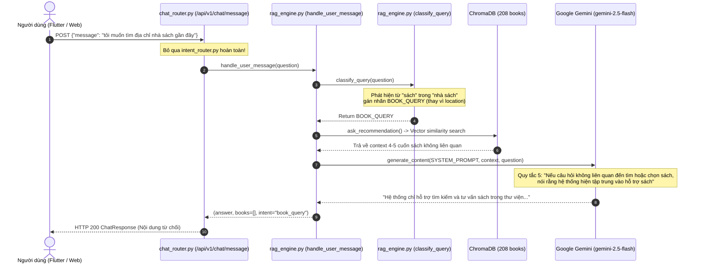

# BÁO CÁO AUDIT & TRUY VẾT HỆ THỐNG TÌM KIẾM ĐỊA ĐIỂM (LOCATION FEATURE AUDIT)

**Dự án:** XÂY DỰNG HỆ THỐNG THƯ VIỆN SỐ VÀ CHATBOT GỢI Ý SÁCH THÔNG MINH  
**Đường dẫn:** `E:\Source_Code\book-recommender-chatbot`  
**Ngày thực hiện:** 03/11/2026  
**Chế độ:** Audit độc lập & Khảo sát mã nguồn thực tế (Read-Only, không can thiệp sửa code production)

---

## 1. CÁC TỆP VÀ DÒNG MÃ LIÊN QUAN TRỰC TIẾP

| Thành phần | Đường dẫn tệp | Dòng liên quan | Vai trò & Hiện trạng |
| :--- | :--- | :--- | :--- |
| **Location Service** | [`location_service.py`](file:///e:/Source_Code/book-recommender-chatbot/location_service.py) | L1-L163 | Tìm kiếm nhà sách & thư viện qua SerpApi Google Maps Engine, chuẩn hóa tọa độ, rating, địa chỉ, URL Google Maps & Directions. **(Đang hoạt động tốt độc lập)** |
| **Location Router** | [`backend/routers/location_router.py`](file:///e:/Source_Code/book-recommender-chatbot/backend/routers/location_router.py) | L15-L48 | Endpoint REST API `GET /api/v1/locations/search`. **(HTTP 200 OK, trả về JSON hợp lệ)** |
| **Location Schema** | [`backend/schemas/location_schema.py`](file:///e:/Source_Code/book-recommender-chatbot/backend/schemas/location_schema.py) | L7-L29 | Schema Pydantic: `LocationSearchRequest`, `LocationItem`, `LocationSearchResponse`. |
| **Intent Router** | [`intent_router.py`](file:///e:/Source_Code/book-recommender-chatbot/intent_router.py) | L74-L96, L114-L121 | Phân loại Intent vị trí (`location_bookstore`, `location_library`, `set_location`, `location_help`). Nhận diện đúng `"tôi muốn tìm địa chỉ nhà sách gần đây"` là `location_bookstore`. |
| **Chat Router (FastAPI)** | [`backend/routers/chat_router.py`](file:///e:/Source_Code/book-recommender-chatbot/backend/routers/chat_router.py) | L98-L106, L154-L160 | Điểm lỗi kiến trúc: Gọi thẳng `rag_engine.handle_user_message(...)`, **bỏ qua hoàn toàn `intent_router.py`** và không tích hợp `location_service`. |
| **RAG Engine** | [`rag_engine.py`](file:///e:/Source_Code/book-recommender-chatbot/rag_engine.py) | L290-L295, L783-L819 | `classify_query()` bắt chữ `"sách"` trong `"nhà sách"` thành `BOOK_QUERY`, đẩy sang RAG ChromaDB và kích hoạt Anti-Hallucination từ chối trả lời. |
| **RAG Prompt Rules** | [`rag_engine.py`](file:///e:/Source_Code/book-recommender-chatbot/rag_engine.py) | L49-L69 (Quy tắc 5) | *"Nếu câu hỏi không liên quan đến tìm hoặc chọn sách, hãy lịch sự nói rằng hệ thống hiện tập trung vào hỗ trợ sách."* |
| **Streamlit Client (Cũ)** | [`app.py`](file:///e:/Source_Code/book-recommender-chatbot/app.py) | L817-L863, L1618-L1650 | Luồng hoạt động hoàn chỉnh trước đây: Gọi `classify_intent` -> `handle_location_request` -> `st.map` -> Thẻ địa điểm. |
| **Flutter Chat UI** | [`mobile_app/lib/presentation/widgets/chat_bubble.dart`](file:///e:/Source_Code/book-recommender-chatbot/mobile_app/lib/presentation/widgets/chat_bubble.dart) | L147-L299 | Chỉ render `ChatSourceBook` từ RAG kho sách, **chưa có widget hiển thị `LocationItem`**. |
| **Flutter API Service** | [`mobile_app/lib/services/api_service.dart`](file:///e:/Source_Code/book-recommender-chatbot/mobile_app/lib/services/api_service.dart) | L1-L525 | **Thiếu hoàn toàn** hàm gọi endpoint `GET /api/v1/locations/search`. |
| **Flutter Dependencies** | [`mobile_app/pubspec.yaml`](file:///e:/Source_Code/book-recommender-chatbot/mobile_app/pubspec.yaml) | L9-L29 | Không có `url_launcher` (mở Google Maps), không có `geolocator` hoặc map widget. |

---

## 2. TRUY VẾT LUỒNG XỬ LÝ HIỆN TẠI (TRACEABILITY MATRIX)

### 2.1. Luồng xử lý câu hỏi *"tôi muốn tìm địa chỉ nhà sách gần đây"* khi gửi từ Chat:


### 2.2. Luồng xử lý trước đây trên Streamlit (`app.py`):
1. Nhận `question` từ `st.chat_input`.
2. Gọi `intent_router.classify_intent(question)`:
   - Regex/Keywords nhận dạng: `"nha sach"` + `"gan day"` => Intent là `FIND_BOOKSTORE` (`"location_bookstore"`).
3. Kiểm tra địa điểm người dùng:
   - Nếu câu hỏi có địa danh (VD: "tôi ở Đà Nẵng"): trích xuất `extract_user_location(question)`.
   - Nếu chưa có: hỏi lại *"Bạn đang ở khu vực nào? Ví dụ: Huế, Đà Nẵng hoặc Hà Nội."*
4. Khi đã có vị trí:
   - Gọi `handle_location_request(question, user_location)`.
   - Gọi `location_service.search_bookstores(location)`.
   - Gọi SerpApi Google Maps Engine, trả về danh sách nhà sách thực tế (tên, địa chỉ, rating, tọa độ lat/lng, URL Google Maps).
5. Render kết quả:
   - Hiển thị bản đồ `st.map(DataFrame(points))`.
   - Hiển thị các thẻ thông tin nhà sách với nút bấm chuyển hướng sang Google Maps (`st.link_button`).

---

## 3. NGUYÊN NHÂN CHÍNH KHIẾN YÊU CẦU ĐỊA ĐIỂM BỊ TỪ CHỐI

### Nguyên nhân 1: Ngắt kết nối kiến trúc tại `chat_router.py`
Trong quá trình chuyển đổi giao diện từ Streamlit sang Backend FastAPI + Flutter:
- `backend/routers/chat_router.py` (cả `/message` và `/stream`) được lập trình chỉ gọi trực tiếp `rag_engine.handle_user_message()`.
- Router chat **không sử dụng `intent_router.py`**, không có phân nhánh xử lý cho các intent phi-RAG như `location_bookstore`, `location_library`, `set_location`, `location_help`.

### Nguyên nhân 2: Phân loại nhầm Intent trong `rag_engine.py` (`classify_query`)
- Tại `rag_engine.py` (dòng 293):
  ```python
  if any(term in normalized for term in _BOOK_TERMS):
      return BOOK_QUERY
  ```
  Trong đó `_BOOK_TERMS` chứa từ `"sach"`. Cụm từ `"nhà sách"` bị chuẩn hóa thành `"nha sach"`. Do đó, câu hỏi `"tôi muốn tìm địa chỉ nhà sách gần đây"` bị nhận nhầm thành `BOOK_QUERY` (truy vấn tìm sách trong thư viện) thay vì intent địa điểm.

### Nguyên nhân 3: Hàng rào Anti-Hallucination của Prompt RAG
- Khi bị chuyển vào luồng `ask_recommendation()`, ChromaDB tìm kiếm vector tương đồng trong 208 đầu sách thư viện và nạp các cuốn sách này vào prompt.
- `SYSTEM_PROMPT` của Gemini (dòng 55-56) quy định nghiêm ngặt:
  > *5. Nếu câu hỏi không liên quan đến tìm hoặc chọn sách, hãy lịch sự nói rằng hệ thống hiện tập trung vào hỗ trợ sách.*
- Vì người dùng hỏi địa chỉ thực tế bên ngoài mà không hỏi về nội dung cuốn sách nào trong kho, mô hình Gemini tuân thủ triệt để quy tắc an toàn và từ chối: *"Hệ thống chỉ hỗ trợ tìm kiếm và tư vấn sách trong thư viện..."*.

---

## 4. ĐÁNH GIÁ TRẠNG THÁI: PHẦN ĐANG HOẠT ĐỘNG VS PHẦN THIẾU

### 4.1. Những phần ĐANG HOẠT ĐỘNG TỐT (Verified với dữ liệu thực):
1. **Core Location Service (`location_service.py`)**:
   - Tích hợp SerpApi Google Maps Engine (`engine=google_maps`, `hl=vi`, `gl=vn`).
   - `SERPAPI_API_KEY` trong `.env` hợp lệ (64 ký tự).
   - Kiểm thử thực tế: Gọi `search_bookstores('Ho Chi Minh', 2)` thành công, trả về dữ liệu thật từ Google Maps (Nhà sách Hải An, NXB Kim Đồng Cống Quỳnh kèm đầy đủ GPS lat/lng, rating, địa chỉ, URL chỉ đường).
2. **REST API Endpoint (`backend/routers/location_router.py`)**:
   - Endpoint `GET /api/v1/locations/search?location=Ho+Chi+Minh&kind=bookstore&limit=2` phản hồi **HTTP 200 OK**.
   - Trả về cấu trúc JSON đúng chuẩn `LocationSearchResponse` kèm `fallback_urls`.
3. **Intent Classification Logic (`intent_router.py`)**:
   - Hàm `classify_intent("tôi muốn tìm địa chỉ nhà sách gần đây")` trả về chính xác: `location_bookstore`.
   - Các hàm chuẩn hóa địa danh `normalize_user_location` và trích xuất vị trí `extract_user_location` hoạt động đúng (được kiểm chứng bởi 15/15 unit tests PASS).
4. **Bộ kiểm thử tự động**:
   - `tests/test_library_services.py`: 15/15 tests PASS 100% bao gồm cả test mock SerpApi, Google Maps URL generation, và location intent extraction.

### 4.2. Những phần CHƯA HOẠT ĐỘNG HOẶC BỊ THIẾU:
1. **Liên kết giữa Chat và Location trên Backend**:
   - Chưa có logic điều phối trong `chat_router.py`: Khi intent là `location_*`, backend không tự động gọi `location_service` để trả về danh sách địa điểm hoặc hướng dẫn người dùng nhập vị trí.
   - `ChatResponse` schema (`backend/schemas/chat_schema.py`) chưa có trường chứa danh sách địa điểm `locations: list[LocationItem]`.
2. **Phía Flutter App (`mobile_app`)**:
   - **Chưa có API Call**: `mobile_app/lib/services/api_service.dart` chưa có method gọi `GET /api/v1/locations/search`.
   - **Chưa có Model**: `mobile_app/lib/models/` chưa có model cho dữ liệu địa điểm (nhà sách/thư viện).
   - **Chưa có UI hiển thị địa điểm**: `chat_bubble.dart` và `ai_chat_screen.dart` chỉ hiển thị thẻ sách `ChatSourceBook`, hoàn toàn không có widget hiển thị thẻ nhà sách/thư viện, địa chỉ, khoảng cách, rating hay nút mở chỉ đường.
   - **Chưa có màn hình bản đồ**: Flutter app hiện không có màn hình Map riêng biệt hay nhúng map view.
   - **Thiếu thư viện mở link**: `mobile_app/pubspec.yaml` chưa có package `url_launcher` để người dùng click mở liên kết Google Maps trên trình duyệt Windows.
3. **Vấn đề vị trí người dùng trên Windows Desktop**:
   - Trên Windows Desktop, việc lấy tọa độ GPS tự động qua phần cứng thiết bị thường không khả thi hoặc bị chặn bởi Windows Location Permissions.
   - Dự án đã có thiết kế fallback rất tốt trong `intent_router.py` (cho phép người dùng nhập thành phố/quận/huyện bằng text như *"Hà Nội"*, *"Đà Nẵng"*, *"TP.HCM"*), nhưng luồng này hiện chỉ tồn tại trên giao diện Streamlit cũ, chưa được đưa vào Flutter.

---

## 5. PHƯƠNG ÁN KHÔI PHỤC TỐI THIỂU & AN TOÀN NHẤT (RECOMMENDED MINIMAL RESTORATION)

Để khôi phục hoàn chỉnh chức năng tìm kiếm địa điểm mà **tuyệt đối không phá vỡ kiến trúc RAG, không ảnh hưởng đến Gemini embedding/retrieval kho sách 208 cuốn và giữ nguyên các API contract hiện có**, phương án triển khai tối ưu gồm 3 bước:

### Bước 1: Điều phối Intent an toàn tại Chat Router Backend (`backend/routers/chat_router.py`)
- Trong `send_chat_message` và `send_chat_message_stream`, trước khi gọi RAG engine:
  - Gọi `intent = classify_intent(chat_req.message)`.
  - Nếu `intent in {FIND_BOOKSTORE, FIND_LIBRARY, LOCATION_SEARCH, LOCATION_HELP, SET_LOCATION}`:
    - Trích xuất địa điểm bằng `extract_user_location(chat_req.message)`.
    - Nếu có địa điểm: Gọi `search_nearby_bookstores` hoặc `search_nearby_libraries` từ `location_service.py`. Sinh câu trả lời thân thiện kèm thông tin nhà sách/thư viện tìm được và liên kết Google Maps.
    - Nếu chưa có địa điểm: Phản hồi hướng dẫn người dùng cung cấp vị trí: *"Bạn muốn tìm nhà sách/thư viện ở khu vực nào? (Ví dụ: Hà Nội, Đà Nẵng, TP.HCM...)"*.
  - Nếu không thuộc các intent địa điểm trên: Giữ nguyên 100% luồng gọi `rag_engine.handle_user_message(...)`.

### Bước 2: Bổ sung Intent Location vào `rag_engine.py` (Phòng vệ chiều sâu)
- Trong `rag_engine.py:classify_query()`, cập nhật quy tắc nhận diện để từ `"nhà sách"`, `"nha sach"`, `"thu vien"` không bị gom thô bạo vào `_BOOK_TERMS`. Nếu câu hỏi có chứa cụm từ hỏi địa điểm (`"ở đâu"`, `"gần đây"`, `"địa chỉ"`), chuyển hướng sang xử lý conversational hoặc trả về intent địa điểm thay vì ép vào `ask_recommendation()`.

### Bước 3: Tích hợp hiển thị phía Flutter Client (`mobile_app`)
- **Trong Chat Bubble**: Khi tin nhắn phản hồi chứa thông tin địa điểm hoặc URL Google Maps, hiển thị thẻ địa điểm trực quan với nút **"Xem trên Google Maps / Chỉ đường"**.
- **Thêm `url_launcher` vào `pubspec.yaml`**: Để hỗ trợ click mở Google Maps trên trình duyệt mặc định của Windows.
- **Fallback nhập vị trí**: Người dùng có thể gõ trực tiếp địa điểm vào khung chat (ví dụ: *"Tìm nhà sách ở Cầu Giấy"* hoặc *"nhà sách gần Quận 1 TP.HCM"*), hệ thống tự động nhận diện thông qua `extract_user_location` mà không cần quyền GPS hệ thống phức tạp trên Windows.

