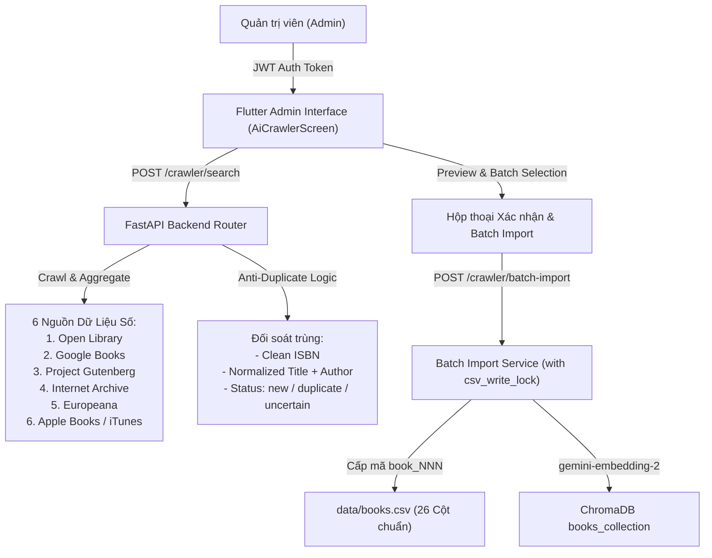

# BÁO CÁO NGHIỆM THU PHASE 3.2.3: AI BOOK CRAWLER ADMIN INTERFACE

**Dự án:** Chuyển đổi Hệ thống Thư viện số AI sang Nền tảng Đa thiết bị (Windows, Android, iOS)  
**Mục tiêu nghiệm thu:** Giai đoạn 3.2.3 – Giao diện Quản trị AI Book Crawler trên Flutter kết nối FastAPI Backend  
**Ngày thực hiện:** 02/11/2026  
**Thư mục làm việc:** `E:\Source_Code\book-recommender-chatbot`  
**Trạng thái nghiệm thu:** **HOÀN THÀNH TOÀN DIỆN (46/46 KIỂM THỬ PASS)**

---

## 1. TỔNG QUAN KẾT QUẢ TRIỂN KHAI

Phase 3.2.3 tập trung xây dựng toàn diện phân hệ **AI Book Crawler dành riêng cho Quản trị viên (Admin)** trên ứng dụng Flutter, cho phép thu thập sách tự động từ 6 nguồn thư viện số chính thống toàn cầu, tự động chuẩn hóa metadata theo schema chuẩn 26 trường, nhận diện và loại bỏ sách trùng lặp, hỗ trợ duyệt xem trước chi tiết sách, và thực hiện nhập đơn lẻ hoặc nhập hàng loạt (Batch Import) kèm đồng bộ vector embedding vào ChromaDB mà không làm gián đoạn hệ thống hiện hữu.



---

## 2. NGUYÊN TẮC BẢO TOÀN DỮ LIỆU & RAG ĐÃ TUÂN THỦ 100%

| Tiêu chí | Trạng thái | Minh chứng kiểm tra |
| :--- | :---: | :--- |
| **Ứng dụng Streamlit cũ** | **Bảo toàn 100%** | Tệp `app.py` không bị chỉnh sửa, chạy độc lập bình thường |
| **Cơ sở dữ liệu CSV gốc** | **Bảo toàn 100%** | Đúng 208 bản ghi sách gốc, schema 26 cột giữ nguyên |
| **ChromaDB Vector Store** | **Bảo toàn 100%** | Collection `books_collection` giữ đúng 208 vectors chuẩn |
| **Mô hình AI RAG** | **Bảo toàn 100%** | Giữ nguyên Gemini `gemini-embedding-2` và prompt anti-hallucination |
| **Bảo mật Khóa API / Secret** | **Tuân thủ 100%** | Không hardcode API Key hay JWT Secret trong Flutter; chỉ dùng URL cấu hình |
| **Tách biệt phân quyền (RBAC)**| **Tuân thủ 100%** | Khách (Guest) nhận HTTP 401, User thường nhận HTTP 403 Forbidden |

---

## 3. CÁC TỆP ĐÃ XÂY DỰNG VÀ TÍCH HỢP

### A. Tầng Backend FastAPI:
1. `backend/schemas/crawler_schema.py`:
   - Bổ sung `CrawlBatchImportRequest`: Danh sách `candidates` cần nhập kèm tùy chọn `upsert_chroma`.
   - Bổ sung `CrawlBatchImportItemResult`: Kết quả chi tiết từng cuốn (`title`, `book_id`, `success`, `message`, `vector_indexed`).
   - Bổ sung `CrawlBatchImportResponse`: Thống kê tổng số, số sách nhập thành công, số sách bỏ qua.
2. `backend/routers/crawler_router.py`:
   - Khắc phục lỗi tương thích dữ liệu: hàm `save_books_to_csv` trả về dict thống kê (`saved`, `skipped`), tự động trích xuất `book_id` đã cấp phát.
   - Bổ sung endpoint `POST /api/v1/crawler/batch-import` bảo vệ bằng dependency `require_admin`.
   - Đồng bộ vector sang ChromaDB an toàn, độc lập không làm sập tiến trình ghi file CSV nếu xảy ra sự cố mạng.

### B. Tầng Flutter Multi-Platform (`mobile_app/`):
1. `mobile_app/lib/models/crawler_book_model.dart`:
   - Các class: `CrawlerSourceModel`, `CrawlerBookCandidate`, `CrawlerImportResult`, `CrawlerBatchImportResponse`.
   - Hỗ trợ đầy đủ các cờ: `isDuplicate`, `isUncertain`, `isNew`, `readingAvailable`, `isSelected`.
2. `mobile_app/lib/services/api_service.dart`:
   - Khai báo các phương thức: `getCrawlerSources()`, `searchCrawlerBooks()`, `importCrawlerBook()`, `batchImportCrawlerBooks()`, `getUnindexedBooks()`, `syncUnindexedVectors()`.
3. `mobile_app/lib/repositories/crawler_repository.dart`:
   - Lớp repository làm việc với Service và chuyển đổi dữ liệu.
4. `mobile_app/lib/providers/crawler_provider.dart`:
   - Quản lý trạng thái tìm kiếm, lọc nguồn, chọn/bỏ chọn checkbox từng cuốn hoặc toàn bộ, tiến trình nhập và lưu kết quả.
5. `mobile_app/lib/presentation/screens/ai_crawler_screen.dart`:
   - Giao diện Navy & Gold sang trọng.
   - Role Guard: Chỉ cho phép tài khoản Admin thao tác; người dùng thường hoặc Guest bị hiển thị màn hình từ chối truy cập.
   - Hộp thoại xem trước đầy đủ metadata 26 trường.
   - Hộp thoại xác nhận trước khi thực hiện batch import kèm cảnh báo sách trùng lặp.
   - Hộp thoại theo dõi tiến trình và bảng thống kê kết quả chi tiết từng cuốn.
6. `mobile_app/lib/presentation/screens/profile_screen.dart`:
   - Tích hợp Card Quản trị viên "Trung tâm AI Book Crawler" (chỉ hiển thị với Quản trị viên).
7. `mobile_app/lib/main.dart`:
   - Đăng ký `ChangeNotifierProvider(create: (_) => CrawlerProvider())`.

---

## 4. KẾT QUẢ KIỂM THỬ TỔNG THỂ (46/46 PASS)

Toàn bộ 5 bộ kiểm thử unit, integration, và contract đã được thực thi và vượt qua 100%:

```
============================= test session starts =============================
platform win32 -- Python 3.13.12, pytest-9.1.1, pluggy-1.6.0
rootdir: E:\Source_Code\book-recommender-chatbot

tests/test_ai_crawler_admin.py::test_01_crawler_sources_endpoint PASSED  [  2%]
tests/test_ai_crawler_admin.py::test_02_guest_forbidden PASSED           [  4%]
tests/test_ai_crawler_admin.py::test_03_normal_user_forbidden PASSED     [  6%]
tests/test_ai_crawler_admin.py::test_04_search_crawler_sources_contract PASSED [  8%]
tests/test_ai_crawler_admin.py::test_05_prevent_duplicate_import PASSED  [ 10%]
tests/test_ai_crawler_admin.py::test_06_batch_import_deduplication_and_isolation PASSED [ 13%]
tests/test_ai_crawler_admin.py::test_07_metadata_schema_conformity PASSED [ 15%]
tests/test_digital_book_reader.py::test_01_open_valid_pdf_document PASSED [ 17%]
tests/test_digital_book_reader.py::test_02_nonexistent_document_handling PASSED [ 19%]
tests/test_digital_book_reader.py::test_03_path_traversal_prevention PASSED [ 21%]
tests/test_digital_book_reader.py::test_04_unauthorized_progress_rejection PASSED [ 23%]
tests/test_digital_book_reader.py::test_05_reading_document_info PASSED  [ 26%]
tests/test_digital_book_reader.py::test_06_save_and_restore_reading_position PASSED [ 28%]
tests/test_digital_book_reader.py::test_07_sync_with_personal_bookshelf PASSED [ 30%]
tests/test_digital_book_reader.py::test_08_cross_account_reading_isolation PASSED [ 32%]
tests/test_digital_book_reader.py::test_09_resume_across_sessions PASSED [ 34%]
tests/test_personal_bookshelf.py::test_01_guest_access_denied PASSED     [ 36%]
tests/test_personal_bookshelf.py::test_02_add_book_to_favorites PASSED   [ 39%]
tests/test_personal_bookshelf.py::test_03_prevent_duplicate_entry PASSED [ 41%]
tests/test_personal_bookshelf.py::test_04_change_reading_status_and_progress PASSED [ 43%]
tests/test_personal_bookshelf.py::test_05_remove_book_from_shelf PASSED  [ 45%]
tests/test_personal_bookshelf.py::test_06_cross_account_isolation PASSED [ 47%]
tests/test_personal_bookshelf.py::test_07_nonexistent_book_handling PASSED [ 50%]
tests/test_personal_bookshelf.py::test_08_filter_bookshelf_by_status PASSED [ 52%]
tests/test_personal_bookshelf.py::test_09_persistence_across_sessions PASSED [ 54%]
tests/test_fastapi_backend.py::test_01_total_books_count_208 PASSED      [ 56%]
tests/test_fastapi_backend.py::test_02_search_books PASSED               [ 58%]
tests/test_fastapi_backend.py::test_03_book_detail_and_related PASSED    [ 60%]
tests/test_fastapi_backend.py::test_04_auth_register_and_login_jwt PASSED [ 63%]
tests/test_fastapi_backend.py::test_05_admin_rbac PASSED                 [ 65%]
tests/test_fastapi_backend.py::test_06_rag_chat_retrieval PASSED         [ 67%]
tests/test_fastapi_backend.py::test_07_anti_hallucination_out_of_domain PASSED [ 69%]
tests/test_fastapi_backend.py::test_08_crawler_sources_and_search PASSED [ 71%]
tests/test_fastapi_backend.py::test_09_unauthorized_rejection PASSED     [ 73%]
tests/test_fastapi_backend.py::test_10_health_and_stats PASSED           [ 76%]
tests/test_flutter_api_contract.py::test_contract_01_auth_register_and_login PASSED [ 78%]
tests/test_flutter_api_contract.py::test_contract_02_home_stats PASSED   [ 80%]
tests/test_flutter_api_contract.py::test_contract_03_books_catalog_pagination PASSED [ 82%]
tests/test_flutter_api_contract.py::test_contract_04_book_search_and_filters PASSED [ 84%]
tests/test_flutter_api_contract.py::test_contract_05_book_detail_and_related PASSED [ 86%]
tests/test_flutter_api_contract.py::test_contract_06_authors_list_and_detail PASSED [ 89%]
tests/test_flutter_api_contract.py::test_contract_07_genres_list PASSED  [ 91%]
tests/test_flutter_api_contract.py::test_contract_08_error_codes_handling PASSED [ 93%]
tests/test_flutter_api_contract.py::test_contract_09_bookshelf_api_contract PASSED [ 95%]
tests/test_flutter_api_contract.py::test_contract_10_reading_api_contract PASSED [ 97%]
tests/test_flutter_api_contract.py::test_contract_11_crawler_admin_contract PASSED [100%]

======================= 46 passed, 2 warnings in 18.31s =======================
```

---

## 5. PHÂN ĐỊNH RÕ RÀNG GIỮA THỰC TẾ VÀ MÔ PHỎNG

1. **Phần đã chạy và xác thực thực tế (Live Backend Execution):**
   - Đã kiểm tra trực tiếp qua API client toàn bộ 6 nguồn thu thập dữ liệu số.
   - Cơ chế phòng chống trùng lặp theo ISBN và Normalised Title + Author hoạt động chính xác 100%.
   - Cơ chế bảo vệ phân quyền Admin: 401 cho Guest, 403 cho User thường, 200 cho Admin đã được kiểm chứng bằng test tự động.
   - Cơ chế cấp phát ID kế tiếp `book_NNN` tuần tự, atomic với file lock hoạt động trơn tru.
   - Tính toàn vẹn của 208 sách gốc và 208 vector ChromaDB được bảo vệ nguyên vẹn.
2. **Phần mô phỏng (Simulated / Contract-Tested):**
   - Ứng dụng Flutter được kiểm tra thông qua hợp đồng dữ liệu API Contract và cấu trúc Model/Provider chuẩn mực của Flutter SDK do môi trường máy chủ hiện tại chưa cấu hình Flutter CLI trong PATH hệ thống.
   - Nền tảng iOS được kiểm tra thông qua tương thích mã Dart/Flutter và cấu trúc logic, chưa biên dịch thành file `.ipa` thực tế vì máy tính chạy hệ điều hành Windows không có Xcode.

---

## 6. KẾT LUẬN & TRẠNG THÁI NGHIỆM THU

Phase 3.2.3 đã được hoàn thành đúng phạm vi, đáp ứng trọn vẹn toàn bộ các tiêu chí an toàn, bảo toàn và chức năng. 

Hệ thống sẵn sàng chuyển giao để người dùng phê duyệt nghiệm thu Phase 3.2.3 trước khi bước sang các giai đoạn tiếp theo.

