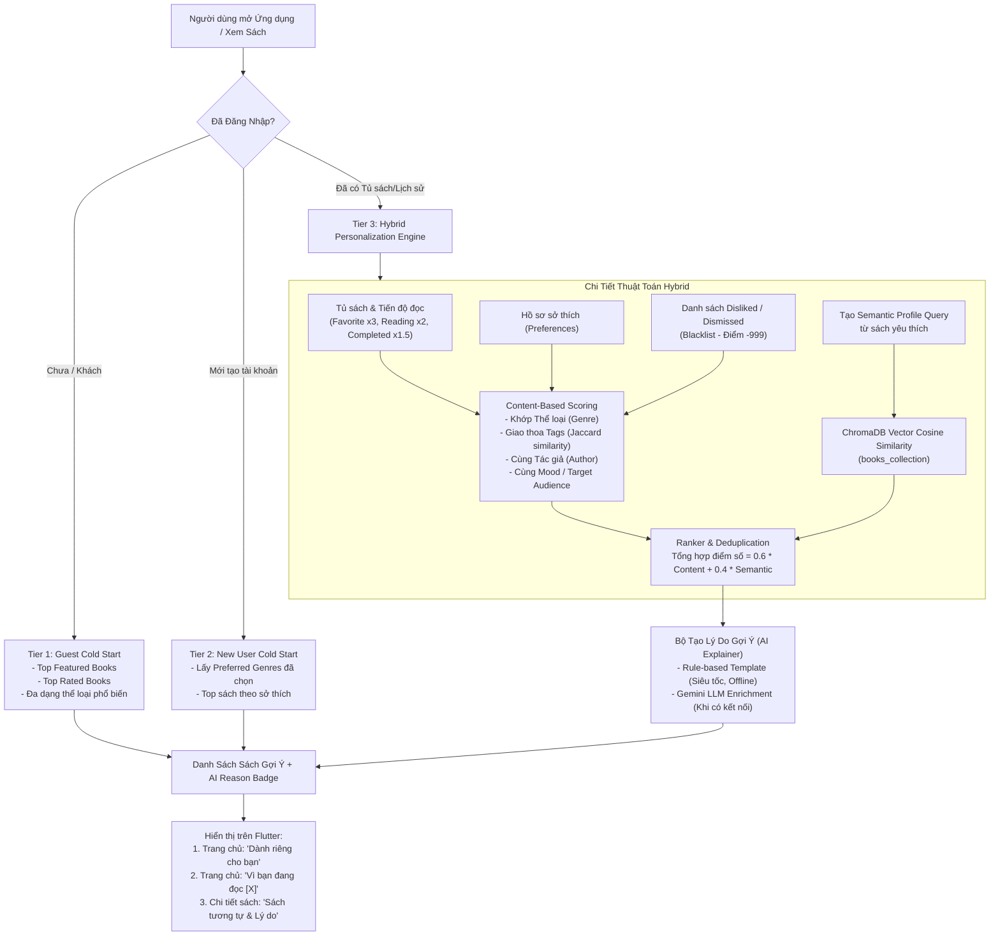

# KẾ HOẠCH TRIỂN KHAI CHI TIẾT PHASE 3.3: AI BOOK RECOMMENDATION CÁ NHÂN HÓA

**Dự án:** Chuyển đổi Hệ thống Thư viện số AI sang Nền tảng Đa thiết bị (Windows, Android, iOS)  
**Giai đoạn:** Phase 3.3 – AI Gợi ý sách cá nhân hóa theo từng người dùng  
**Ngày lập kế hoạch:** 02/11/2026  
**Thư mục làm việc:** `E:\Source_Code\book-recommender-chatbot`  
**Trạng thái:** **BẢN KẾ HOẠCH ĐỀ XUẤT (CHỜ PHÊ DUYỆT - CHƯA CODE)**

---

## 1. NGUYÊN TẮC BẢO TOÀN HỆ THỐNG TUÂN THỦ NGHIÊM NGẶT

- **Không viết lại và không sửa backend hiện có** nếu không có lỗi được chứng minh.
- **Không thay đổi mô hình Gemini, Google GenAI SDK, ChromaDB** hoặc logic RAG hiện tại.
- **Không xóa hoặc tạo lại collection `books_collection`**, không ingest lại 208 sách hiện có.
- **Không sửa ứng dụng Streamlit cũ (`app.py`)**.
- **Không thay đổi dữ liệu gốc:** `data/books.csv` (208 dòng, 26 cột), `authors.csv`, `genres.csv`, `users.json`.
- **Không đưa Gemini API Key hoặc JWT Secret vào mã nguồn Flutter.**
- **Bảo toàn 100% các phân hệ đã nghiệm thu:** Chatbot AI Streaming (Phase 3.1), Personal Bookshelf (Phase 3.2.1), Digital Book Reader (Phase 3.2.2), AI Book Crawler Admin Interface (Phase 3.2.3).
- **Phân tách dữ liệu:** Dữ liệu cá nhân hóa lưu riêng theo từng tài khoản tại `data/recommendations/{username}.json`, tuyệt đối không ghi đè vào dữ liệu dùng chung.

---

## 2. KHẢO SÁT & TÁI SỬ DỤNG MÃ NGUỒN HIỆN TẠI

### A. Thành phần tái sử dụng được ngay:
1. **Dữ liệu nền tảng:**
   - `data/books.csv`: 208 cuốn sách với 26 trường thuộc tính phong phú (`genre`, `tags`, `target_audience`, `mood`, `difficulty`, `rating`, `summary`, `author`, `reading_available`).
   - `data/bookshelves/{username}.json`: Tủ sách cá nhân (danh sách `favorite`, `reading`, `completed`).
   - `data/reading_progress/{username}.json`: Lịch sử đọc và tiến độ trang hiện tại (`current_page`, `progress_percent`).
2. **Logic nghiệp vụ Backend:**
   - `book_service.py`:
     - `get_related_books`: Thuật toán content-based cơ sở dựa trên sự tương đồng về thể loại (`genre`), từ khóa (`tags`), tác giả (`author`) và điểm đánh giá (`rating`).
     - `get_featured_books`: Danh sách sách tiêu biểu phục vụ Cold Start.
     - `get_book_by_id`, `filter_books`.
   - `backend/core/database.py`: `get_books_df()`, `load_users()`, cơ chế khóa luồng `csv_write_lock`, `users_write_lock`.
   - `backend/core/security.py`: `get_current_user` (xác thực bắt buộc), `get_current_user_optional` (hỗ trợ cả khách vãng lai).
   - `ChromaDB` (`books_collection` 208 vectors) + `rag_engine.py`: Tìm kiếm semantic vector tương đồng theo ngữ nghĩa mô tả nội dung sách.
3. **Thành phần Flutter UI & State:**
   - `BookModel`, `BookCard`: Hiển thị sách theo phong cách Navy & Gold.
   - `AuthProvider`: Xác thực và định danh `currentUser`.
   - `BookshelfProvider`: Lấy danh sách trạng thái tủ sách tức thì để làm phong phú gợi ý.

### B. Dữ liệu và chức năng còn thiếu cần bổ sung:
1. **Hồ sơ sở thích đọc sách (User Preferences):**
   - Danh sách thể loại quan tâm (`preferred_genres`), tác giả ưa thích (`preferred_authors`), mục tiêu đọc (`reading_goal`).
2. **Lịch sử phản hồi gợi ý (Recommendation Feedback):**
   - Phản hồi chủ động: Thích (`liked: true`), Không thích (`liked: false` / Blacklist).
   - Lý do không thích (ví dụ: *"Không thích thể loại này"*, *"Đã đọc bên ngoài"*).
3. **Cơ chế giải thích lý do đề xuất (Explainable AI Recommendations):**
   - Lý do đề xuất minh bạch cho từng cuốn (ví dụ: *"Được gợi ý vì bạn đã thích cuốn Atomic Habits và quan tâm đến Thói quen & Kỷ luật"*).

---

## 3. KIẾN TRÚC & THUẬT TOÁN GỢI Ý ĐỀ XUẤT (HYBRID RECOMMENDATION ENGINE)

Hệ thống kết hợp đa tầng (Multi-tier Hybrid Architecture) nhằm tối ưu độ chính xác, tốc độ phản hồi dưới 150ms và không lãng phí hạn ngạch Gemini API:



### Chi tiết cách tính điểm (Scoring Function):
$$\text{Score}(B) = w_{\text{genre}} \cdot S_{\text{genre}} + w_{\text{tags}} \cdot S_{\text{tags}} + w_{\text{author}} \cdot S_{\text{author}} + w_{\text{vector}} \cdot S_{\text{vector}} + w_{\text{rating}} \cdot \text{Rating}(B)$$
- Nếu sách nằm trong danh mục **Disliked**: Điểm $= -\infty$ (Loại bỏ vĩnh viễn).
- Nếu sách **đã có trong tủ sách** của người dùng: Loại bỏ (không gợi ý lại sách đang đọc hoặc đã hoàn thành, trừ khi xem sách liên quan).

---

## 4. THIẾT KẾ DỮ LIỆU & BỘ NHỚ LƯU TRỮ

Mỗi người dùng có một tệp cấu hình và phản hồi độc lập: `data/recommendations/{safe_username}.json`.

```json
{
  "username": "reader_user",
  "updated_at": "2026-11-02T15:30:00Z",
  "preferences": {
    "preferred_genres": ["Kỹ năng sống", "Kinh tế - Khởi nghiệp"],
    "preferred_authors": ["James Clear"],
    "reading_goal": "Phát triển bản thân"
  },
  "feedback": {
    "book_001": {
      "liked": true,
      "updated_at": "2026-11-02T15:35:00Z"
    },
    "book_014": {
      "liked": false,
      "reason": "Không quan tâm chủ đề này",
      "updated_at": "2026-11-02T15:36:00Z"
    }
  },
  "cached_recommendations": {
    "generated_at": "2026-11-02T15:30:00Z",
    "book_ids": ["book_002", "book_008", "book_015"]
  }
}
```

---

## 5. THIẾT KẾ API BACKEND MỚI

Tạo router mới: `backend/routers/recommendation_router.py` (prefix: `/api/v1/recommendations`, tags: `Recommendations`):

| Phương thức | Đường dẫn API | Xác thực | Mô tả chức năng |
| :--- | :--- | :---: | :--- |
| `GET` | `/api/v1/recommendations/for-you` | Tùy chọn (Optional) | Trả về danh sách sách gợi ý cho user hiện tại (hoặc cold-start nếu là khách) kèm lý do đề xuất. |
| `GET` | `/api/v1/recommendations/continue-reading` | Bắt buộc (User) | Gợi ý sách tương đồng với các cuốn user đang đọc (`status = reading`). |
| `GET` | `/api/v1/recommendations/similar/{book_id}`| Công khai | Trả về các sách tương đồng với cuốn cụ thể kèm lý do. |
| `GET` | `/api/v1/recommendations/preferences` | Bắt buộc (User) | Lấy hồ sơ sở thích thể loại của người dùng. |
| `POST`| `/api/v1/recommendations/preferences` | Bắt buộc (User) | Cập nhật hồ sơ thể loại quan tâm. |
| `POST`| `/api/v1/recommendations/feedback` | Bắt buộc (User) | Gửi phản hồi Thích (`liked: true`) hoặc Không thích (`liked: false`). |
| `POST`| `/api/v1/recommendations/refresh` | Bắt buộc (User) | Xóa cache và tính toán lại danh sách gợi ý mới. |

---

## 6. THIẾT KẾ GIAO DIỆN FLUTTER

1. **Trang Chủ (`home_screen.dart`):**
   - Bổ sung Section: **"AI Gợi ý dành riêng cho bạn"** đặt ở vị trí ưu tiên sau Hero Banner.
   - Bổ sung Section: **"Tiếp tục mạch đọc"** (nếu người dùng có sách đang đọc).
   - Mỗi thẻ sách có thêm **AI Reason Pill** màu vàng ánh kim (`Color(0xFFD4AF37)`) giải thích ngắn gọn lý do.
   - Thêm nút tương tác nhanh: Biểu tượng Thích / Không thích (Thumbs Up / Down) trực tiếp trên Card hoặc BottomSheet.
2. **Chi tiết Sách (`book_detail_screen.dart`):**
   - Nâng cấp Section sách liên quan thành: **"Sách tương tự & Lý do gợi ý"** hiển thị độ tương đồng ngữ nghĩa.
3. **Cài Đặt Sở Thích (`profile_screen.dart` hoặc Sheet riêng):**
   - Thêm Card **"Sở thích đọc sách của bạn"**: Gồm các Filter Chips cho phép người dùng chọn/bỏ chọn nhanh các thể loại yêu thích (như Tâm lý, Kỹ năng, Văn học, Công nghệ...).
4. **Trạng thái Người dùng mới (Cold-Start Dialog):**
   - Sau khi đăng ký tài khoản lần đầu, hiển thị Modal ngắn gọn 3 giây: *"Chọn 3 chủ đề bạn yêu thích nhất để AI cá nhân hóa thư viện cho bạn"*.

---

## 7. ĐÁNH GIÁ RỦI RO & GIẢI PHÁP KIỂM SOÁT

| Rủi ro tiềm ẩn | Mức độ | Biện pháp kiểm soát & Giải pháp |
| :--- | :---: | :--- |
| **Quá tải / Cạn hạn ngạch Gemini API** | Cao | Thuật toán xếp hạng thực hiện bằng Scoring nội bộ & Vector ChromaDB cục bộ. Lý do gợi ý được tạo bằng Template Engine thông minh; Gemini chỉ dùng để bổ trợ phân tích khi có quota. Thời gian sinh gợi ý < 150ms. |
| **Ô nhiễm dữ liệu giữa các tài khoản** | Cao | Mỗi người dùng có một tệp JSON riêng trong `data/recommendations/`. Áp dụng `_sanitize_username` ngăn Path Traversal. Tuyệt đối không lưu vào `books.csv`. |
| **Hiện tượng Filter Bubble (Chỉ gợi ý sách cùng loại)** | Trung bình | Tích hợp tham số ngẫu nhiên hóa nhẹ (Exploration factor 15%) để gợi ý thêm một số sách chất lượng cao ngoài vùng an toàn giúp độc giả mở rộng tầm nhìn. |
| **Người dùng Dislike toàn bộ gợi ý** | Thấp | Khi danh sách gợi ý bị cạn do Dislike, tự động chuyển sang Top sách hay nhất của các thể loại liên đới chưa đọc. |

---

## 8. KẾ HOẠCH CHIA NHỎ PHASE 3.3 (CÁC GIAI ĐOẠN ĐỘC LẬP)

Để bảo đảm kiểm soát chất lượng và an toàn hệ thống, Phase 3.3 được chia làm 3 bước nhỏ:

### Giai đoạn 3.3.1: Recommendation Engine & Backend APIs
- **Nội dung:** Xây dựng `recommendation_service.py`, `recommendation_schema.py`, `recommendation_router.py`.
- **Nghiệm thu:** 10/10 bài kiểm thử backend độc lập (`tests/test_recommendations.py`), đảm bảo không sửa 208 sách gốc và ChromaDB.

### Giai đoạn 3.3.2: Flutter Models, Providers & UI Integration
- **Nội dung:** Xây dựng `RecommendationModel`, `RecommendationProvider`, tích hợp các Section gợi ý vào `home_screen.dart`, `book_detail_screen.dart`.
- **Nghiệm thu:** Contract tests trên Flutter API và giao diện tương tác Thích/Không thích.

### Giai đoạn 3.3.3: Cold-Start Experience & Full System Regression
- **Nội dung:** Tích hợp bộ chọn thể loại sở thích ban đầu, kiểm tra toàn bộ 55+ test cases của toàn hệ thống (từ Phase 1 đến Phase 3.3).
- **Nghiệm thu:** Báo cáo tổng kết toàn diện `PHASE3_3_FINAL_ACCEPTANCE_REPORT.md`.

---

## 9. DANH SÁCH FILE DỰ KIẾN THAY ĐỔI / TẠO MỚI

### Tạo mới:
- `recommendation_service.py`: Lõi thuật toán gợi ý hybrid, tính điểm và sinh lý do.
- `backend/schemas/recommendation_schema.py`: Schemas Pydantic cho Request/Response.
- `backend/routers/recommendation_router.py`: Các API endpoints gợi ý, sở thích và phản hồi.
- `tests/test_recommendations.py`: Bộ kiểm thử backend tự động.
- `mobile_app/lib/models/recommendation_model.dart`: Model dữ liệu Flutter.
- `mobile_app/lib/repositories/recommendation_repository.dart`: Repository gọi API.
- `mobile_app/lib/providers/recommendation_provider.dart`: Quản lý trạng thái gợi ý và feedback.
- `mobile_app/lib/presentation/widgets/recommendation_carousel.dart`: Widget hiển thị carousel gợi ý kèm badge lý do.

### Cập nhật (Nhẹ, không phá vỡ logic cũ):
- `backend/main.py`: Đăng ký `recommendation_router`.
- `mobile_app/lib/core/constants/api_constants.dart`: Khai báo endpoint recommendations.
- `mobile_app/lib/services/api_service.dart`: Thêm phương thức gọi API recommendations.
- `mobile_app/lib/presentation/screens/home_screen.dart`: Thêm Section "Gợi ý dành cho bạn".
- `mobile_app/lib/presentation/screens/profile_screen.dart`: Thêm liên kết tùy chỉnh sở thích.
- `mobile_app/lib/main.dart`: Đăng ký `RecommendationProvider`.

---

## 10. TIÊU CHÍ NGHIỆM THU PHASE 3.3

1. Khách chưa đăng nhập nhận được gợi ý sách chất lượng cao (Top featured/rating) mà không gặp lỗi.
2. Người dùng đã đăng nhập nhận được danh sách gợi ý cá nhân hóa dựa trên thể loại yêu thích và các sách trong tủ sách.
3. Mỗi gợi ý đều có lý do đề xuất rõ ràng, logic và dễ hiểu.
4. Khi người dùng bấm "Không thích" (Dislike), cuốn sách đó biến mất khỏi gợi ý và không lặp lại.
5. Khi người dùng bấm "Thích" (Like), hệ thống tăng trọng số cho các sách tương tự.
6. Dữ liệu sở thích và phản hồi được lưu trữ độc lập theo từng tài khoản, không lẫn lộn giữa User A và User B.
7. Toàn bộ 208 sách và 208 vectors ChromaDB được bảo toàn 100%. Toàn bộ 46 test cases hiện hữu tiếp tục PASS 100%.

---

> [!IMPORTANT]
> **Cam kết:** Hiện tại hệ thống **CHỈ PHÂN TÍCH VÀ LẬP KẾ HOẠCH**, tuyệt đối **CHƯA VIẾT HOẶC SỬA MÃ NGUỒN**. Toàn bộ hệ thống được giữ nguyên trạng và đang chờ chỉ thị phê duyệt từ Quý Người dùng.

