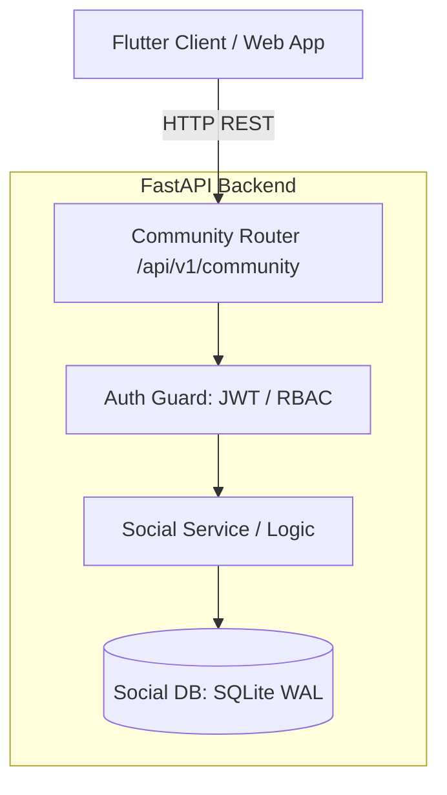
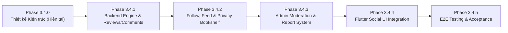

# TÀI LIỆU PHÂN TÍCH VÀ THIẾT KẾ HỆ THỐNG SOCIAL READING & COMMUNITY (PHASE 3.4.0)

**Dự án:** Hệ thống Thư viện số và Chatbot Gợi ý Sách Thông minh (AI Digital Library System)  
**Giai đoạn:** Phase 3.4.0 – Phân tích và Thiết kế Kiến trúc Cộng đồng Đọc sách  
**Ngày lập tài liệu:** 02/11/2026  
**Trạng thái:** 📋 **THIẾT KẾ KIẾN TRÚC & CHỜ PHÊ DUYỆT (CHƯA TRIỂN KHAI CODE)**  

---

## I. TỔNG QUAN VÀ MỤC TIÊU CỦA PHASE 3.4

Hệ sinh thái thư viện số hiện đã hoàn thành các giai đoạn nền tảng:
- **Phase 1 & 2:** FastAPI Backend & Flutter Multi-platform (Windows, Android, iOS).
- **Phase 3.1:** Chatbot AI RAG Streaming với Google Gemini và ChromaDB.
- **Phase 3.2:** Tủ sách cá nhân (Personal Bookshelf), Trình đọc số (Digital Book Reader), Quản trị viên thu thập sách (AI Book Crawler Admin).
- **Phase 3.3:** Động cơ gợi ý sách AI cá nhân hóa (Hybrid Recommendation Engine) và giao diện Flutter toàn diện.

**Phase 3.4 – Social Reading & Community** mở rộng nền tảng từ trải nghiệm cá nhân hóa đơn lẻ sang không gian kết nối cộng đồng độc giả văn minh, bao gồm 9 trụ cột chức năng:
1. **Đánh giá và nhận xét sách (Reviews):** Viết review, xếp hạng sao (1–5★), đánh dấu tiết lộ nội dung (Spoiler Alert).
2. **Bình luận và trao đổi (Comments & Replies):** Thảo luận dưới bài đánh giá hoặc dòng hoạt động đọc sách (hỗ trợ phân cấp 2 cấp: Parent - Reply).
3. **Thích và tương tác (Reactions/Likes):** Like/Unlike bài review và bình luận; đếm số lượt tương tác thời gian thực.
4. **Hồ sơ người đọc công khai (Public User Profiles):** Tên hiển thị, avatar, bio, huy hiệu độc giả, thống kê đọc sách cá nhân.
5. **Tủ sách công khai / riêng tư (Bookshelf Privacy):** Cấu hình linh hoạt quyền hiển thị tủ sách (Công khai toàn phần, Chỉ bạn bè, hoặc Riêng tư).
6. **Theo dõi độc giả (Follow / Unfollow):** Kết nối người dùng có cùng gu đọc sách, quản lý danh sách Followers & Following.
7. **Dòng hoạt động đọc sách được chia sẻ (Social Activity Feed):** Bảng tin tự động cập nhật khi bạn bè thêm sách mới, hoàn thành sách, hoặc đăng review mới.
8. **Báo cáo và kiểm duyệt (Reports & Community Moderation):** Cơ chế báo cáo nội dung xấu độc/spam/spoiler; bảng điều khiển dành riêng cho Quản trị viên (Admin) để xử lý vi phạm.
9. **Khám phá cộng đồng (Community Discovery):** Bảng xếp hạng độc giả tích cực, các đầu sách được cộng đồng thảo luận nhiều nhất tuần/tháng.

---

## II. KHẢO SÁT KIẾN TRÚC HIỆN TẠI

Quá trình khảo sát trực tiếp mã nguồn thực tế tại `E:\Source_Code\book-recommender-chatbot`:

### 1. Kiến trúc Backend & Xác thực (FastAPI)
- **Cấu hình Router:** `backend/main.py` đăng ký tập trung các router thông qua prefix `/api/v1` (`auth_router`, `book_router`, `bookshelf_router`, `reading_router`, `recommendation_router`, `crawler_router`, `chat_router`).
- **Xác thực & Danh tính (`backend/core/security.py`):**
  - Sử dụng JWT (`OAuth2PasswordBearer`) với thuật toán HS256 (`SECRET_KEY`).
  - Hàm `get_current_user` giải mã token, xác thực người dùng dựa trên `data/users.json`.
  - Hàm `get_current_user_optional` hỗ trợ cả người dùng đăng nhập và khách vãng lai (Guest).
  - Phân quyền RBAC qua hàm `require_admin`, kiểm tra trường `role == "admin"` của token và hồ sơ người dùng.
- **Dữ liệu người dùng (`data/users.json`):**
  - Lưu trữ dictionary: `username -> {hashed_password, role, password (legacy)}`.
  - Chưa có thông tin mở rộng về profile xã hội (display_name, bio, avatar, privacy_settings).

### 2. Dữ liệu Tủ sách & Tiến độ đọc
- **Tủ sách (`data/bookshelves/{username}.json`):**
  - Lưu trữ theo file JSON độc lập cho từng user với khóa ghi an toàn `threading.Lock()`.
  - Mỗi mục sách có `id`, `book_id`, `status` (`favorite`, `reading`, `completed`), `progress_page`, `total_pages`, `added_at`.
  - Mặc định hiện tại: Tất cả file tủ sách được bảo vệ nghiêm ngặt ở cấp người dùng, chỉ có chủ tài khoản mới truy cập được.
- **Tiến độ đọc (`data/reading_progress/{username}.json`):**
  - Lưu tiến độ đọc chi tiết theo sách: `current_page`, `total_pages`, `progress_percent`, `last_read_location`.

### 3. Động cơ Gợi ý & Tương tác AI
- **Sở thích & Feedback (`data/recommendations/{username}.json`):**
  - Chứa `preferences` (`preferred_genres`, `preferred_authors`, `reading_goal`) và `feedback` (`book_id -> {liked, reason, updated_at}`).
  - Toàn bộ cơ chế recommendation hiện tại hoạt động độc lập theo tài khoản, không chia sẻ chéo.

### 4. Kiến trúc Frontend Flutter
- **State Management:** Provider pattern (`AuthProvider`, `BookshelfProvider`, `BookProvider`, `RecommendationProvider`, `GenreProvider`).
- **Networking:** `DioClient` bọc `Dio` với `InterceptorsWrapper`, tự động đính kèm `Authorization: Bearer <token>`, xử lý URL động và map lỗi mạng sang tiếng Việt qua `ApiException`.
- **Màn hình hiện có:**
  - `HomeScreen`: Hiển thị Tiếp tục mạch đọc, Gợi ý AI, Sách nổi bật.
  - `BookDetailScreen`: Chi tiết sách, nút Tủ sách, Sách cùng thể loại, Sách AI tương tự.
  - `ProfileScreen`: Thông tin tài khoản, Tủ sách tóm tắt, Cài đặt sở thích & mục tiêu AI, Kết nối máy chủ.
  - `DigitalReaderScreen`: Trình đọc PDF/EPUB với lưu tiến độ tự động.

---

## III. ĐÁNH GIÁ KHẢ NĂNG MỞ RỘNG & LỰA CHỌN CÔNG NGHỆ LƯU TRỮ

### 1. Phân tích bài toán dữ liệu của Social Reading
Khác với dữ liệu cá nhân hóa (Bookshelf, Chat History, Progress) vốn có cấu trúc 1-1 (User $\rightarrow$ Data) rất phù hợp với File-per-user JSON, tính năng Cộng đồng mang các đặc tính:
- **Quan hệ mạng lưới nhiều-nhiều (N-N):** Một cuốn sách có hàng trăm Reviews; mỗi Review có hàng chục Comments và hàng trăm Likes; một User theo dõi hàng ngàn User khác.
- **Tần suất đọc cao và tính đồng thời:** Khi một bài review nổi bật xuất hiện, hàng trăm người dùng có thể Like hoặc Comment đồng thời.
- **Nhu cầu truy vấn tổng hợp và sắp xếp:**
  - *"Lấy 10 review mới nhất của cuốn sách `book_001` kèm số lượt like và trạng thái user hiện tại đã like hay chưa"*
  - *"Lấy dòng hoạt động của tất cả người mà tôi đang theo dõi, xếp theo thời gian mới nhất, phân trang 20 mục/lần"*
  - *"Tính điểm đánh giá trung bình (average rating) của cuốn sách dựa trên toàn bộ review"*

### 2. So sánh các phương án lưu trữ

| Tiêu chí so sánh | Phương án A: JSON File-based | Phương án B: SQLite Database (`sqlite3`) |
| :--- | :--- | :--- |
| **Bản chất kiến trúc** | Lưu trữ các tệp JSON riêng biệt trong `data/social/` | Sử dụng 1 tệp CSDL nhẹ `data/social_community.db` |
| **Phụ thuộc bên ngoài** | Không cài thêm package | **Không cài thêm package** (Tận dụng `sqlite3` có sẵn trong Python chuẩn) |
| **Hiệu năng JOIN & Lọc** | 🔴 Kém. Phải đọc và parse hàng trăm tệp JSON vào RAM rồi lặp thủ công. | 🟢 Xuất sắc. Hỗ trợ JOIN, B-Tree Indexing, lọc và phân trang cực nhanh. |
| **Độ an toàn khi ghi đồng thời (Concurrency)** | 🟡 Dễ tắc nghẽn (Lock contention) khi nhiều user like cùng lúc. | 🟢 WAL Mode (Write-Ahead Logging): Cho phép hàng trăm kết nối đọc song song với kết nối ghi. |
| **Rủi ro ảnh hưởng hệ thống cũ** | 🟢 Độc lập với `books.csv` và ChromaDB | 🟢 **Hoàn toàn độc lập** với `books.csv`, ChromaDB và Streamlit. |
| **Toàn vẹn quan hệ (Foreign Keys)** | 🔴 Phải tự code logic kiểm tra cascade, dễ mồ côi dữ liệu. | 🟢 Ràng buộc Foreign Key tự động, Cascade delete sạch sẽ khi cần. |

> [!IMPORTANT]
> **KẾT LUẬN THIẾT KẾ:**  
> Đề xuất sử dụng **SQLite Database chuyên biệt cho Social Community** (`data/social_community.db`), kết hợp tầng `threading.Lock` hoặc Connection Pool chuẩn của Python standard library `sqlite3`.  
> - **Lý do quyết định:** Không làm thay đổi bất kỳ cơ chế nào của `books.csv` (208 sách), ChromaDB (208 vectors) hay `users.json`, nhưng mang lại sức mạnh truy vấn quan hệ, index nhanh và chống race-condition cho các tương tác mạng xã hội.

---

## IV. THIẾT KẾ MÔ HÌNH DỮ LIỆU CHI TIẾT (DATA SCHEMA)

### 1. Bảng `user_profiles` (Hồ sơ người đọc công khai)
Mở rộng từ danh tính trong `users.json` mà không làm thay đổi file auth gốc:

| Tên trường | Kiểu dữ liệu | Ràng buộc | Mô tả |
| :--- | :--- | :--- | :--- |
| `username` | `VARCHAR(64)` | **PK** | Tên đăng nhập (trùng khớp với `users.json`) |
| `display_name` | `VARCHAR(100)` | NOT NULL | Tên hiển thị công khai trên cộng đồng |
| `avatar_url` | `TEXT` | DEFAULT '' | Đường dẫn ảnh đại diện hoặc avatar preset |
| `bio` | `TEXT` | DEFAULT '' | Giới thiệu ngắn về bản thân và gu đọc |
| `bookshelf_privacy` | `VARCHAR(20)` | DEFAULT 'public' | Quyền xem tủ sách: `'public'`, `'friends'`, `'private'` |
| `show_reading_activity` | `BOOLEAN` | DEFAULT 1 | Chia sẻ hoạt động đọc lên cộng đồng (1: Bật, 0: Tắt) |
| `created_at` | `DATETIME` | NOT NULL | Thời gian tạo hồ sơ |
| `updated_at` | `DATETIME` | NOT NULL | Thời gian cập nhật gần nhất |

### 2. Bảng `reviews` (Đánh giá và nhận xét sách)

| Tên trường | Kiểu dữ liệu | Ràng buộc | Mô tả |
| :--- | :--- | :--- | :--- |
| `id` | `VARCHAR(36)` | **PK** | UUID định danh bài review |
| `book_id` | `VARCHAR(64)` | NOT NULL, INDEX | Mã sách được review (liên kết logic với `books.csv`) |
| `username` | `VARCHAR(64)` | NOT NULL, INDEX | Người viết review (FK logic $\rightarrow$ `user_profiles.username`) |
| `rating` | `INTEGER` | NOT NULL, CHECK (1 $\le$ rating $\le$ 5) | Số sao đánh giá từ 1 đến 5 |
| `title` | `VARCHAR(200)` | NOT NULL | Tiêu đề bài nhận xét |
| `content` | `TEXT` | NOT NULL | Nội dung chi tiết bài nhận xét |
| `contains_spoiler` | `BOOLEAN` | DEFAULT 0 | Cảnh báo tiết lộ nội dung trước |
| `likes_count` | `INTEGER` | DEFAULT 0 | Số lượt thích bài review (bộ đếm denormalized để query nhanh) |
| `comments_count` | `INTEGER` | DEFAULT 0 | Số lượt bình luận (bộ đếm denormalized) |
| `status` | `VARCHAR(20)` | DEFAULT 'active' | Trạng thái: `'active'`, `'hidden'`, `'flagged'` |
| `created_at` | `DATETIME` | NOT NULL, INDEX | Thời gian đăng |
| `updated_at` | `DATETIME` | NOT NULL | Thời gian sửa |

*Quy tắc duy nhất:* `UNIQUE(book_id, username)` $\rightarrow$ Chống việc một người dùng spam nhiều bài review trên cùng một cuốn sách. Nếu muốn thay đổi đánh giá, người dùng thực hiện cập nhật (PUT).

### 3. Bảng `comments` (Bình luận và phản hồi)

| Tên trường | Kiểu dữ liệu | Ràng buộc | Mô tả |
| :--- | :--- | :--- | :--- |
| `id` | `VARCHAR(36)` | **PK** | UUID bình luận |
| `review_id` | `VARCHAR(36)` | NOT NULL, INDEX | FK logic $\rightarrow$ `reviews.id` (ON DELETE CASCADE) |
| `username` | `VARCHAR(64)` | NOT NULL, INDEX | Người bình luận |
| `parent_comment_id` | `VARCHAR(36)` | NULL, INDEX | Trả lời cho bình luận nào (NULL nếu là bình luận gốc cấp 1) |
| `content` | `TEXT` | NOT NULL | Nội dung bình luận |
| `likes_count` | `INTEGER` | DEFAULT 0 | Số lượt thích bình luận |
| `status` | `VARCHAR(20)` | DEFAULT 'active' | Trạng thái: `'active'`, `'hidden'`, `'flagged'` |
| `created_at` | `DATETIME` | NOT NULL, INDEX | Thời gian gửi bình luận |
| `updated_at` | `DATETIME` | NOT NULL | Thời gian sửa bình luận |

### 4. Bảng `reactions` (Thích nội dung)

| Tên trường | Kiểu dữ liệu | Ràng buộc | Mô tả |
| :--- | :--- | :--- | :--- |
| `id` | `VARCHAR(36)` | **PK** | UUID tương tác |
| `username` | `VARCHAR(64)` | NOT NULL | Người thực hiện tương tác |
| `target_type` | `VARCHAR(20)` | NOT NULL | Loại đối tượng: `'review'` hoặc `'comment'` |
| `target_id` | `VARCHAR(36)` | NOT NULL | Khóa chính của đối tượng (review_id hoặc comment_id) |
| `created_at` | `DATETIME` | NOT NULL | Thời điểm thích |

*Quy tắc duy nhất:* `UNIQUE(username, target_type, target_id)` $\rightarrow$ Chống double-like triệt để từ tầng cơ sở dữ liệu.

### 5. Bảng `follows` (Mối quan hệ bạn đọc)

| Tên trường | Kiểu dữ liệu | Ràng buộc | Mô tả |
| :--- | :--- | :--- | :--- |
| `id` | `VARCHAR(36)` | **PK** | UUID theo dõi |
| `follower_username` | `VARCHAR(64)` | NOT NULL, INDEX | Người chủ động theo dõi |
| `following_username` | `VARCHAR(64)` | NOT NULL, INDEX | Người được theo dõi |
| `created_at` | `DATETIME` | NOT NULL | Thời điểm bắt đầu theo dõi |

*Quy tắc duy nhất:* `UNIQUE(follower_username, following_username)` và `CHECK (follower_username != following_username)` (Không tự theo dõi chính mình).

### 6. Bảng `activity_feed` (Dòng hoạt động đọc sách chia sẻ)

| Tên trường | Kiểu dữ liệu | Ràng buộc | Mô tả |
| :--- | :--- | :--- | :--- |
| `id` | `VARCHAR(36)` | **PK** | UUID sự kiện |
| `username` | `VARCHAR(64)` | NOT NULL, INDEX | Người tạo sự kiện |
| `activity_type` | `VARCHAR(30)` | NOT NULL | `'added_book'`, `'reading_progress'`, `'completed_book'`, `'posted_review'` |
| `book_id` | `VARCHAR(64)` | NOT NULL | Sách liên quan đến sự kiện |
| `meta_data` | `TEXT` | DEFAULT '{}' | Dữ liệu kèm theo dạng JSON (số trang, rating, trích đoạn review) |
| `is_public` | `BOOLEAN` | DEFAULT 1 | Công khai hay giới hạn |
| `created_at` | `DATETIME` | NOT NULL, INDEX | Thời gian xảy ra sự kiện |

### 7. Bảng `reports` (Báo cáo vi phạm nội dung)

| Tên trường | Kiểu dữ liệu | Ràng buộc | Mô tả |
| :--- | :--- | :--- | :--- |
| `id` | `VARCHAR(36)` | **PK** | UUID báo cáo |
| `reporter_username` | `VARCHAR(64)` | NOT NULL | Người gửi báo cáo |
| `target_type` | `VARCHAR(20)` | NOT NULL | `'review'`, `'comment'`, `'user'` |
| `target_id` | `VARCHAR(36)` | NOT NULL | Định danh đối tượng bị tố cáo |
| `reason` | `VARCHAR(50)` | NOT NULL | `'spam'`, `'harassment'`, `'inappropriate'`, `'unmarked_spoiler'`, `'other'` |
| `details` | `TEXT` | DEFAULT '' | Mô tả chi tiết lý do |
| `status` | `VARCHAR(20)` | DEFAULT 'pending' | `'pending'`, `'resolved'`, `'dismissed'` |
| `admin_notes` | `TEXT` | DEFAULT '' | Ghi chú của quản trị viên |
| `created_at` | `DATETIME` | NOT NULL, INDEX | Thời điểm báo cáo |

*Quy tắc duy nhất:* `UNIQUE(reporter_username, target_type, target_id)` $\rightarrow$ Chống spam báo cáo liên tục cùng một nội dung.

---

## V. THIẾT KẾ HỆ THỐNG REST API

Toàn bộ các API được nhóm vào prefix `/api/v1/community`.



### 1. Phân nhóm API chi tiết

| Nhóm chức năng | Method | Endpoint | Quyền hạn | Mô tả chức năng |
| :--- | :--- | :--- | :--- | :--- |
| **Reviews** | `GET` | `/api/v1/community/books/{book_id}/reviews` | Public / Guest | Xem danh sách đánh giá của 1 sách (phân trang, lọc rating, sort by likes/date) |
| | `GET` | `/api/v1/community/reviews/{review_id}` | Public / Guest | Xem chi tiết 1 bài review |
| | `POST` | `/api/v1/community/books/{book_id}/reviews` | User | Viết bài đánh giá sách (Chặn duplicate: 1 review/user/book) |
| | `PUT` | `/api/v1/community/reviews/{review_id}` | User (Owner) | Sửa bài đánh giá của chính mình |
| | `DELETE` | `/api/v1/community/reviews/{review_id}` | Owner / Admin | Xóa bài đánh giá (Admin có quyền xóa nếu vi phạm) |
| **Comments** | `GET` | `/api/v1/community/reviews/{review_id}/comments`| Public / Guest | Xem danh sách bình luận dưới bài review (phân trang) |
| | `POST` | `/api/v1/community/reviews/{review_id}/comments`| User | Gửi bình luận hoặc trả lời bình luận (`parent_comment_id`) |
| | `DELETE` | `/api/v1/community/comments/{comment_id}` | Owner / Admin | Xóa bình luận |
| **Reactions** | `POST` | `/api/v1/community/reactions/toggle` | User | Thích hoặc Bỏ thích bài review hoặc comment (Idempotent toggle) |
| **Profiles** | `GET` | `/api/v1/community/profile/{username}` | Public / Guest | Xem hồ sơ độc giả công khai (tôn trọng privacy_settings) |
| | `PUT` | `/api/v1/community/profile/me` | User | Cập nhật hồ sơ cá nhân (display_name, bio, avatar, privacy) |
| | `GET` | `/api/v1/community/profile/{username}/bookshelf` | Dynamic Auth | Xem tủ sách của độc giả (kiểm tra `public`, `friends`, `private`) |
| **Follow** | `POST` | `/api/v1/community/follow/{target_username}` | User | Theo dõi người đọc |
| | `DELETE` | `/api/v1/community/follow/{target_username}` | User | Bỏ theo dõi người đọc |
| | `GET` | `/api/v1/community/profile/{username}/followers` | Public / Guest | Xem danh sách người đang theo dõi |
| | `GET` | `/api/v1/community/profile/{username}/following` | Public / Guest | Xem danh sách người mà độc giả này đang theo dõi |
| **Activity Feed**| `GET` | `/api/v1/community/feed` | User | Xem bảng tin hoạt động từ những người đang theo dõi |
| | `GET` | `/api/v1/community/feed/discover` | Public / Guest | Bảng tin khám phá cộng đồng (Top reviews, sách thảo luận sôi nổi) |
| **Moderation** | `POST` | `/api/v1/community/reports` | User | Gửi báo cáo vi phạm |
| | `GET` | `/api/v1/community/admin/reports` | **Admin Only** | Danh sách báo cáo vi phạm cần duyệt (phân trang, lọc trạng thái) |
| | `POST` | `/api/v1/community/admin/reports/{report_id}/resolve`| **Admin Only**| Xử lý báo cáo (Ẩn review, xóa comment, cảnh cáo) |

### 2. Các cơ chế bảo mật và an toàn dữ liệu bắt buộc
1. **Kiểm tra quyền sở hữu nội dung (IDOR Prevention):**
   Khi người dùng gọi `PUT` hoặc `DELETE` trên review/comment:
   ```python
   if existing_item["username"] != current_user["username"] and current_user.get("role") != "admin":
       raise HTTPException(status_code=403, detail="Bạn không có quyền chỉnh sửa nội dung này")
   ```
2. **Kiểm soát quyền riêng tư tủ sách (Bookshelf Privacy):**
   Khi xem `/api/v1/community/profile/{target_user}/bookshelf`:
   - Nếu `target_user == current_user`: Cho phép xem toàn bộ.
   - Nếu `privacy == 'private'`: Trả về `403 Forbidden` kèm thông báo *"Tủ sách của người dùng này đang ở chế độ riêng tư"*.
   - Nếu `privacy == 'friends'`: Kiểm tra quan hệ 2 chiều (`is_following_each_other`). Nếu không phải bạn bè, từ chối.
3. **Chống Spam & Tấn công Brute-force:**
   - Review title tối đa 200 ký tự; content tối đa 5,000 ký tự.
   - Comment tối đa 1,000 ký tự.
   - Rate limiting: Tối đa 5 review / 10 phút / 1 user; tối đa 30 comments / 10 phút.
4. **Xử lý XSS & Injection:**
   - Backend làm sạch dữ liệu văn bản (Sanitize input, strip dangerous HTML tags).
   - Frontend Flutter render text thuần thông qua widget `Text` chuẩn, không render raw HTML nguy hiểm.

---

## VI. THIẾT KẾ GIAO DIỆN FLUTTER & TRẢI NGHIỆM ĐỘC GIẢ

### 1. Kiến trúc phân tầng Flutter (Layered Architecture)
```
mobile_app/lib/
├── models/
│   ├── review_model.dart
│   ├── comment_model.dart
│   ├── social_profile_model.dart
│   ├── activity_feed_model.dart
│   └── report_model.dart
├── services/
│   └── social_api_service.dart
├── repositories/
│   └── social_repository.dart
├── providers/
│   ├── book_reviews_provider.dart
│   ├── social_feed_provider.dart
│   ├── user_profile_provider.dart
│   └── moderation_provider.dart
└── presentation/
    ├── screens/
    │   ├── community_feed_screen.dart        // Bảng tin cộng đồng (Feed & Discover)
    │   ├── book_reviews_screen.dart          // Danh sách review & chi tiết thảo luận
    │   ├── write_review_screen.dart          // Màn hình viết / sửa review
    │   ├── public_profile_screen.dart        // Xem trang cá nhân độc giả khác
    │   └── admin_moderation_screen.dart      // Bảng kiểm duyệt báo cáo dành cho Admin
    └── widgets/
        ├── review_card.dart                  // Thẻ review với sao, badge spoiler, like/comment buttons
        ├── comment_thread_item.dart          // Bình luận phân cấp và avatar
        ├── activity_feed_card.dart           // Thẻ hiển thị sự kiện đọc sách của bạn bè
        └── star_rating_picker.dart           // Bộ chọn số sao 1-5 mượt mà chuẩn Navy & Gold
```

### 2. Thiết kế giao diện chuẩn Brand Navy & Gold
- **Bảng màu chủ đạo:**
  - Nền ứng dụng: `AppColors.background` (`#F7F9FC`).
  - Thanh tiêu đề & Card: `AppColors.navyDark` (`#0B1F3A`) & `AppColors.surface` (`#FFFFFF`).
  - Điểm nhấn & Sao đánh giá: `AppColors.gold` (`#C9A227`) và `AppColors.goldDark` (`#A38018`).
  - Thẻ spoiler: Nền xám mờ với nút bấm *"Hiển thị nội dung tiết lộ"* kèm icon `Icons.visibility_off_rounded`.
- **Responsive thích ứng trên Windows Desktop & Mobile:**
  - Trên Windows Desktop (width $\ge$ 1100px): Màn hình `CommunityFeedScreen` chia 2 cột: Cột trái (70%) là dòng hoạt động Feed, Cột phải (30%) là Khám phá độc giả nổi bật và Sách thảo luận sôi nổi.
  - Trên Mobile (width < 650px): Chuyển thành dạng Tab cuộn dọc tự nhiên với hỗ trợ `PullToRefresh`.

---

## VII. ĐÁNH GIÁ RỦI RO KỸ THUẬT VÀ PHƯƠNG ÁN PHÒNG NGỪA

| Rủi ro kỹ thuật | Mức độ | Phương án phòng ngừa & Xử lý |
| :--- | :---: | :--- |
| **Xung đột ghi đè đồng thời (Concurrent write collisions) trên Like/Comment** | Cao | Sử dụng SQLite WAL Mode kết hợp database-level atomic operations (`UPDATE reviews SET likes_count = likes_count + 1`) thay vì đọc ra rồi ghi đè. |
| **Ảnh hưởng đến hiệu năng của RAG và AI Recommendation** | Trung bình | Tách biệt hoàn toàn DB Social (`data/social_community.db`) khỏi ChromaDB và `books.csv`. Các API RAG và Gemini không đọc ghi vào bảng Social. |
| **Rò rỉ thông tin riêng tư từ Tủ sách cá nhân** | Cao | Mặc định cấu hình `bookshelf_privacy` là `'public'` hoặc `'private'` theo lựa chọn rõ ràng của user. Backend kiểm tra quyền nghiêm ngặt trước khi trả dữ liệu. |
| **Spam review giả mạo hoặc phá hoại đánh giá sách** | Trung bình | Ràng buộc duy nhất 1 review/user/book; bổ sung bộ lọc kiểm duyệt từ ngữ thô tục; cung cấp công cụ Report cho cộng đồng và Admin Dashboard. |
| **User xóa tài khoản làm mồ côi bài viết** | Thấp | Thiết lập chính sách: Khi xóa user, profile chuyển cờ `status = 'deleted'`; các bài review/comment được ẩn danh hóa (hiển thị tác giả là *"Độc giả ẩn danh"*) để không phá vỡ cấu trúc thảo luận của sách. |

---

## VIII. LỘ TRÌNH TRIỂN KHAI ĐỀ XUẤT (PHASE 3.4.1 ĐẾN 3.4.5)



### 1. Chi tiết phân kỳ từng Phase nhỏ

#### **Phase 3.4.1 – Backend Core Social Engine & Review/Comment APIs**
- **Mục tiêu:** Xây dựng tầng dịch vụ `social_service.py`, CSDL `data/social_community.db`, các endpoint CRUD cho Reviews, Comments, Reactions.
- **Tệp dự kiến tạo/sửa:**
  - `backend/services/social_service.py` (Mới)
  - `backend/schemas/social_schema.py` (Mới)
  - `backend/routers/social_router.py` (Mới)
  - `backend/main.py` (Chỉ đăng ký thêm router `social_router`)
  - `tests/test_social_reviews_api.py` (Mới)
- **Tiêu chí nghiệm thu:** Viết review, sửa review, xóa review, comment phân cấp, toggle like; 100% tests PASS, bảo toàn 208 sách.

#### **Phase 3.4.2 – Follow System, Activity Feed & Public Bookshelf**
- **Mục tiêu:** Quản lý quan hệ Follow/Unfollow, sinh dòng hoạt động `activity_feed`, API xem tủ sách công khai có phân quyền.
- **Tệp dự kiến tạo/sửa:**
  - Mở rộng `backend/services/social_service.py`
  - Mở rộng `backend/routers/social_router.py`
  - `backend/routers/bookshelf_router.py` (Bổ sung endpoint xem tủ sách công khai có kiểm tra privacy)
  - `tests/test_social_feed_and_follow.py` (Mới)
- **Tiêu chí nghiệm thu:** User A follow User B; User B đăng hoạt động $\rightarrow$ User A thấy trên Feed; chặn truy cập tủ sách private của người khác.

#### **Phase 3.4.3 – Community Moderation & Admin Control Center**
- **Mục tiêu:** API Báo cáo vi phạm nội dung, Admin Dashboard kiểm duyệt, ẩn/xóa nội dung xấu.
- **Tệp dự kiến tạo/sửa:**
  - Mở rộng `backend/services/social_service.py` (Reports & Moderation)
  - `tests/test_social_moderation_admin.py` (Mới)
- **Tiêu chí nghiệm thu:** User gửi report; Guest/User thường bị chặn 403 khi vào Admin Report; Admin duyệt hoặc ẩn bài thành công.

#### **Phase 3.4.4 – Flutter Social UI Integration**
- **Mục tiêu:** Kết nối giao diện Flutter trên 3 nền tảng Windows, Android, iOS.
- **Tệp dự kiến tạo/sửa:**
  - `mobile_app/lib/models/review_model.dart`, `comment_model.dart`, `social_profile_model.dart`
  - `mobile_app/lib/services/api_service.dart` (Bổ sung social methods)
  - `mobile_app/lib/repositories/social_repository.dart`
  - `mobile_app/lib/providers/book_reviews_provider.dart`, `social_feed_provider.dart`
  - Các màn hình `book_reviews_screen.dart`, `write_review_screen.dart`, `public_profile_screen.dart`, `community_feed_screen.dart`
  - Tích hợp nút xem Review vào `book_detail_screen.dart`
- **Tiêu chí nghiệm thu:** Giao diện hiển thị đúng chuẩn Navy & Gold, không overflow, tải mượt mà, hỗ trợ like và comment trực tiếp.

#### **Phase 3.4.5 – Kiểm thử nghiệm thu & Đánh giá tải toàn hệ thống**
- **Mục tiêu:** Kiểm thử hồi quy toàn bộ hệ thống (Phase 1, 2, 3.1, 3.2, 3.3 và 3.4), kiểm tra tải đồng thời và lập báo cáo nghiệm thu tổng thể.
- **Tiêu chí nghiệm thu:** Toàn bộ test suite PASS 100%, dữ liệu 208 sách và 208 vectors nguyên vẹn.

---

## IX. BẢO TOÀN HỆ THỐNG VÀ NGUYÊN TẮC BẢO MẬT

1. **Bảo tồn 100% dữ liệu sách gốc:** `data/books.csv` giữ nguyên 208 sách, 26 cột.
2. **Bảo tồn 100% ChromaDB:** `books_collection` giữ nguyên 208 vectors, không xóa hoặc ingest lại.
3. **Bảo tồn RAG Engine & Streamlit:** Không can thiệp vào `rag_engine.py` và `app.py`.
4. **Không cài đặt package ngoài không an toàn:** Toàn bộ giải pháp lưu trữ đề xuất khai thác `sqlite3` có sẵn trong thư viện chuẩn của Python runtime hiện có.
5. **Quy tắc dừng nghiêm ngặt:** Kết thúc Phase 3.4.0 tại đây để báo cáo và chờ phê duyệt. Không tự ý tạo file code triển khai cho Phase 3.4.1.

