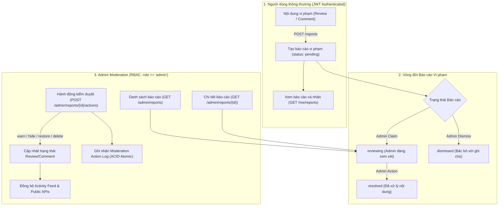

# BÁO CÁO NGHIỆM THU PHASE 3.4.3 – SOCIAL COMMUNITY MODERATION
## HỆ THỐNG BÁO CÁO VÀ KIỂM DUYỆT NỘI DUNG CỘNG ĐỒNG

**Dự án:** Hệ thống Thư viện số và Chatbot Gợi ý Sách Thông minh (AI Digital Library & Recommendation System)  
**Thư mục làm việc:** `E:\Source_Code\book-recommender-chatbot`  
**Giai đoạn:** Phase 3.4.3 – Triển khai Hệ thống Báo cáo Vi phạm, Kiểm duyệt Nội dung Admin và Lịch sử Kiểm duyệt  
**Thời gian hoàn thành:** 02/11/2026  
**Trạng thái kiểm thử:** ✅ **156/156 BÀI TEST PASS 100% (TOÀN BỘ 14 TEST SUITES HỆ THỐNG)**  

---

## 1. TỔNG QUAN KIẾN TRÚC ĐÃ TRIỂN KHAI

Hệ thống **Social Community Moderation** được thiết kế và triển khai hoàn toàn ở tầng Backend theo kiến trúc RESTful bảo mật cao và phân quyền nghiêm ngặt:



---

## 2. CÁC FILE TẠO MỚI

1. `tests/test_social_moderation_phase3_4_3.py`: Bộ kiểm thử chuyên sâu 20 test cases kiểm chứng toàn diện chức năng báo cáo người dùng, phân quyền Admin RBAC, xử lý nội dung (warn/hide/restore/delete), chống IDOR, race condition và tính toàn vẹn CSDL.
2. `PHASE_3_4_3_MODERATION_REPORT.md`: Báo cáo nghiệm thu kỹ thuật chi tiết giai đoạn Phase 3.4.3.

---

## 3. CÁC FILE CHỈNH SỬA

1. `backend/services/community_db.py`: Bổ sung **Migration phiên bản 3** (`schema_version = 3`) tạo 2 bảng `reports` và `moderation_actions` kèm khóa ngoại, ràng buộc CHECK, index chuyên biệt, được bọc an toàn trong `BEGIN TRANSACTION; ... COMMIT;`.
2. `backend/schemas/community_schema.py`: Bổ sung các Pydantic models: `ReportCreate`, `ReportResponse`, `ReportListResponse`, `ReportDismissRequest`, `ModerationActionRequest`, `ModerationActionResponse`, `ModerationActionListResponse`, `AdminReportDetailResponse`, `AdminReportListResponse`.
3. `backend/services/community_service.py`: Triển khai 7 hàm nghiệp vụ kiểm duyệt: `create_report`, `get_my_reports`, `get_admin_reports`, `get_admin_report_detail`, `claim_report`, `dismiss_report`, `execute_moderation_action`, `get_moderation_actions`. Cập nhật `get_review_detail` để ẩn các bài review bị đánh dấu `hidden` đối với người dùng thông thường.
4. `backend/routers/community_router.py`: Bổ sung 8 REST API endpoints mới (2 endpoint cho User và 6 endpoint kiểm duyệt cho Admin bảo vệ bằng `require_admin`).
5. `tests/audit_phase_3_4_2.py`: Điều chỉnh assertion phiên bản migration sang `v1 >= 2` và `v2 == v1` để tương thích tiến hóa với migration v3.

---

## 4. MIGRATION & DATABASE SCHEMA (VERSION 3)

Hệ thống tái sử dụng CSDL SQLite độc lập `data/social_community.db`. Migration v3 được áp dụng an toàn và nâng `schema_version` lên **3**.

```sql
BEGIN TRANSACTION;

-- 1. Bảng reports (Báo cáo vi phạm từ người dùng)
CREATE TABLE IF NOT EXISTS reports (
    id TEXT PRIMARY KEY,
    reporter_username TEXT NOT NULL,
    target_type TEXT NOT NULL CHECK (target_type IN ('review', 'comment')),
    target_id TEXT NOT NULL,
    reason TEXT NOT NULL CHECK (reason IN ('spam', 'harassment', 'misinformation', 'inappropriate', 'copyright', 'other')),
    description TEXT NOT NULL DEFAULT '',
    status TEXT NOT NULL DEFAULT 'pending' CHECK (status IN ('pending', 'reviewing', 'resolved', 'dismissed')),
    claimed_by TEXT NULL,
    claimed_at TEXT NULL,
    resolved_by TEXT NULL,
    resolved_at TEXT NULL,
    admin_notes TEXT NOT NULL DEFAULT '',
    created_at TEXT NOT NULL,
    updated_at TEXT NOT NULL,
    FOREIGN KEY (reporter_username) REFERENCES user_profiles(username) ON UPDATE CASCADE ON DELETE CASCADE
);

CREATE INDEX IF NOT EXISTS idx_reports_status ON reports(status);
CREATE INDEX IF NOT EXISTS idx_reports_target ON reports(target_type, target_id);
CREATE INDEX IF NOT EXISTS idx_reports_reporter ON reports(reporter_username);
CREATE INDEX IF NOT EXISTS idx_reports_created ON reports(created_at DESC);

-- 2. Bảng moderation_actions (Lịch sử kiểm duyệt bất biến)
CREATE TABLE IF NOT EXISTS moderation_actions (
    id TEXT PRIMARY KEY,
    admin_username TEXT NOT NULL,
    target_type TEXT NOT NULL CHECK (target_type IN ('review', 'comment')),
    target_id TEXT NOT NULL,
    report_id TEXT NULL,
    action TEXT NOT NULL CHECK (action IN ('warn', 'hide', 'restore', 'delete', 'dismiss')),
    previous_status TEXT NOT NULL DEFAULT '',
    new_status TEXT NOT NULL DEFAULT '',
    reason TEXT NOT NULL DEFAULT '',
    created_at TEXT NOT NULL,
    FOREIGN KEY (admin_username) REFERENCES user_profiles(username) ON UPDATE CASCADE ON DELETE RESTRICT,
    FOREIGN KEY (report_id) REFERENCES reports(id) ON DELETE SET NULL
);

CREATE INDEX IF NOT EXISTS idx_mod_target ON moderation_actions(target_type, target_id);
CREATE INDEX IF NOT EXISTS idx_mod_admin ON moderation_actions(admin_username);
CREATE INDEX IF NOT EXISTS idx_mod_created ON moderation_actions(created_at DESC);

COMMIT;
```

---

## 5. DANH SÁCH REST API ĐÃ TRIỂN KHAI

Tất cả các API được tích hợp thống nhất dưới namespace `/api/v1/community`:

### A. API Người dùng (Authenticated User)
| Method & Endpoint | Phân quyền | Mô tả chức năng & HTTP Status |
| :--- | :---: | :--- |
| `POST /api/v1/community/reports` | User (JWT) | Gửi báo cáo vi phạm cho Review hoặc Comment. Chặn tự báo cáo (400), chặn nội dung không tồn tại (404), chặn duplicate report đang xử lý (409). Trả về `201 Created`. |
| `GET /api/v1/community/me/reports` | User (JWT) | Xem danh sách các báo cáo do chính người dùng gửi, hỗ trợ lọc theo trạng thái và phân trang. Trả về `200 OK`. |

### B. API Quản trị viên (Admin RBAC: `require_admin`)
| Method & Endpoint | Phân quyền | Mô tả chức năng & HTTP Status |
| :--- | :---: | :--- |
| `GET /api/v1/community/admin/reports` | Admin Only | Lấy danh sách báo cáo toàn hệ thống; lọc theo `status`, `target_type`; phân trang; trả về kèm bộ đếm `status_counts` (`pending`, `reviewing`, `resolved`, `dismissed`). Trả về `200 OK`. |
| `GET /api/v1/community/admin/reports/{report_id}` | Admin Only | Xem chi tiết báo cáo, nội dung trích xuất thực tế của bài viết/bình luận, tác giả nội dung, thông tin người báo cáo và lịch sử xử lý trước đó. Trả về `200 OK`. |
| `POST /api/v1/community/admin/reports/{report_id}/claim` | Admin Only | Tiếp nhận xử lý báo cáo, chuyển trạng thái `pending` -> `reviewing`. Chặn tranh chấp nếu Admin khác đã tiếp nhận (409 Conflict). Trả về `200 OK`. |
| `POST /api/v1/community/admin/reports/{report_id}/dismiss` | Admin Only | Bác bỏ báo cáo không hợp lệ với ghi chú kiểm duyệt bắt buộc (`notes >= 3 ký tự`). Không thay đổi nội dung gốc. Chuyển trạng thái sang `dismissed`. Trả về `200 OK`. |
| `POST /api/v1/community/admin/reports/{report_id}/actions` | Admin Only | Thực thi hành động kiểm duyệt: `warn` (cảnh cáo), `hide` (ẩn nội dung), `restore` (khôi phục nội dung), `delete` (xóa mềm nội dung). Đồng bộ giải quyết các báo cáo trùng lặp cùng trỏ tới nội dung đó. Trả về `200 OK`. |
| `GET /api/v1/community/admin/moderation-actions` | Admin Only | Truy vấn nhật ký kiểm duyệt bất biến, lọc theo `target_type`, `target_id`, `admin_username`, phân trang theo thời gian giảm dần. Trả về `200 OK`. |

---

## 6. MA TRẬN PHÂN QUYỀN VÀ BẢO MẬT (RBAC & PRIVACY)

| Đối tượng | `POST /reports` | `GET /me/reports` | `GET /admin/reports` | `POST /admin/.../actions` | `GET /admin/moderation-actions` |
| :--- | :---: | :---: | :---: | :---: | :---: |
| **Khách vãng lai (Guest)** | ❌ 401 Unauthorized | ❌ 401 Unauthorized | ❌ 401 Unauthorized | ❌ 401 Unauthorized | ❌ 401 Unauthorized |
| **User thông thường** | ✅ 201 Created | ✅ 200 OK *(Chỉ thấy bài mình)* | ❌ 403 Forbidden | ❌ 403 Forbidden | ❌ 403 Forbidden |
| **Admin (`cong1`, `admin`)** | ✅ 201 Created | ✅ 200 OK | ✅ 200 OK | ✅ 200 OK | ✅ 200 OK |

### Cơ chế bảo mật dữ liệu người báo cáo (Reporter Privacy):
- Người dùng thông thường chỉ có thể xem báo cáo do chính mình tạo ra (`GET /me/reports`).
- Không có API công khai nào trả về danh tính người báo cáo cho tác giả bài viết hay bên thứ ba.
- Quyền Admin được xác thực từ chữ ký mật mã trong JWT token (`role == 'admin'`), client hoàn toàn không thể tự gắn role admin trong request body.

---

## 7. VÒNG ĐỜI BÁO CÁO (REPORT LIFECYCLE)

1. **`pending` (Chờ xử lý):** Trạng thái khởi tạo khi người dùng gửi báo cáo thành công.
2. **`reviewing` (Đang xem xét):** Được kích hoạt khi Admin bấm tiếp nhận (`claim`). Ghi nhận `claimed_by` và `claimed_at`.
3. **`dismissed` (Bác bỏ):** Báo cáo bị từ chối do không có căn cứ hoặc nội dung hợp lệ. Bắt buộc có lý do từ Admin.
4. **`resolved` (Đã xử lý):** Nội dung vi phạm đã được xử lý bằng một trong các hành động (`warn`, `hide`, `restore`, `delete`).

---

## 8. CƠ CHẾ ẨN, XÓA, KHÔI PHỤC VÀ ĐỒNG BỘ NỘI DUNG

| Hành động | Trạng thái Review/Comment | Tác động lên Activity Feed | Tác động lên Public APIs | Đồng bộ báo cáo khác |
| :--- | :---: | :---: | :---: | :--- |
| **`warn`** | Giữ nguyên (`active`) | Không đổi | Không đổi | Đánh dấu `resolved` toàn bộ báo cáo đang chờ cho nội dung này. |
| **`hide`** | Chuyển sang `'hidden'` | Ẩn tức thì (`is_hidden = 1`) | Ẩn khỏi `GET /books/{id}/reviews`, `GET /reviews/{id}/comments` và chi tiết `GET /reviews/{id}` (404 Not Found). | Đánh dấu `resolved` toàn bộ báo cáo đang chờ cho nội dung này. |
| **`restore`** | Chuyển sang `'active'` | Khôi phục hiển thị (`is_hidden = 0`) | Xuất hiện trở lại trong danh sách đánh giá và bình luận công khai. | Không ảnh hưởng báo cáo cũ. |
| **`delete`** | Chuyển sang `'deleted'` (Soft delete) | Xóa vĩnh viễn khỏi feed (`DELETE FROM activity_feed`) | Ẩn hoàn toàn khỏi mọi API công khai, bảo toàn quan hệ khóa ngoại và lịch sử kiểm duyệt. | Đánh dấu `resolved` toàn bộ báo cáo đang chờ cho nội dung này. |

---

## 9. CƠ CHẾ GHI NHẬN NHẬT KÝ KIỂM DUYỆT (MODERATION ACTION LOG)

- **Tính toàn vẹn ACID:** Việc cập nhật trạng thái nội dung (`reviews` / `comments`), chuyển trạng thái báo cáo (`reports`), và chèn bản ghi vào `moderation_actions` được thực thi trong **cùng một giao dịch SQLite duy nhất**. Nếu bất kỳ bước nào thất bại, toàn bộ thao tác tự động rollback 100%.
- **Tính bất biến (Immutable):** Bảng `moderation_actions` không cung cấp bất kỳ API sửa (PUT) hoặc xóa (DELETE) nào. Lịch sử kiểm duyệt được bảo tồn nguyên vẹn làm bằng chứng vận hành.

---

## 10. KẾT QUẢ KIỂM THỬ CONCURRENCY VÀ RACE CONDITION

- **Đồng thời nhận xử lý báo cáo (Race Condition Claim):** Kiểm chứng tại `test_18_concurrent_admin_claim_and_action`: Hai admin đồng thời gửi yêu cầu claim cùng một báo cáo. SQLite xử lý an toàn: một admin nhận thành công (200 OK), admin thứ hai nhận mã lỗi `409 Conflict` (báo cáo đã được tiếp nhận bởi admin trước), không xảy ra xung đột dữ liệu hay lỗi khóa CSDL.
- **Xử lý hàng loạt báo cáo trùng lặp:** Kiểm chứng tại `test_19_multiple_reports_same_target_resolved_together`: Khi 2 hoặc nhiều người dùng cùng báo cáo 1 bài viết, ngay khi Admin thực hiện hành động kiểm duyệt trên 1 báo cáo, tất cả các báo cáo còn lại của bài viết đó đều tự động chuyển sang `resolved` kèm ghi chú đồng bộ.

---

## 11. KẾT QUẢ KIỂM THỬ TEST SUITE PHASE 3.4.3

Đã chạy toàn bộ bộ kiểm thử chuyên biệt `tests/test_social_moderation_phase3_4_3.py`:

| STT | Tên bài kiểm thử | Kết quả | Mô tả kiểm thử |
| :---: | :--- | :---: | :--- |
| 1 | `test_01_user_report_valid_review` | **PASSED** | Người dùng gửi báo cáo Review hợp lệ (201 Created). |
| 2 | `test_02_user_report_valid_comment` | **PASSED** | Người dùng gửi báo cáo Comment hợp lệ (201 Created). |
| 3 | `test_03_block_reporting_nonexistent_content` | **PASSED** | Chặn báo cáo nội dung không tồn tại (404 Not Found). |
| 4 | `test_04_block_self_reporting_own_content` | **PASSED** | Chặn tự báo cáo bài viết của chính mình (400 Bad Request). |
| 5 | `test_05_block_duplicate_pending_reports` | **PASSED** | Chặn gửi báo cáo trùng lặp khi báo cáo trước đang chờ duyệt (409 Conflict). |
| 6 | `test_06_block_regular_user_from_admin_apis` | **PASSED** | Chặn toàn bộ người dùng thông thường truy cập API Admin (403 Forbidden). |
| 7 | `test_07_admin_list_reports_with_filtering_and_counts` | **PASSED** | Admin xem danh sách báo cáo, lọc theo trạng thái và lấy bộ đếm `status_counts`. |
| 8 | `test_08_admin_view_report_detail` | **PASSED** | Admin xem chi tiết nội dung bị báo cáo, tác giả và lịch sử xử lý. |
| 9 | `test_09_admin_claim_report` | **PASSED** | Admin tiếp nhận báo cáo (`pending` -> `reviewing`). |
| 10 | `test_10_admin_dismiss_report` | **PASSED** | Admin bác bỏ báo cáo kèm ghi chú bắt buộc (`dismissed`). |
| 11 | `test_11_admin_hide_review` | **PASSED** | Admin ẩn Review -> Review biến mất khỏi danh sách sách và trả về 404 cho người dùng thường. |
| 12 | `test_12_admin_hide_comment` | **PASSED** | Admin ẩn Comment -> Comment biến mất khỏi danh sách bình luận công khai. |
| 13 | `test_13_admin_delete_content` | **PASSED** | Admin xóa mềm nội dung vi phạm bản quyền nghiêm trọng. |
| 14 | `test_14_moderation_action_log_recorded` | **PASSED** | Ghi nhận chính xác hành động vào bảng `moderation_actions`. |
| 15 | `test_15_reporter_identity_privacy` | **PASSED** | Người dùng khác không thể xem danh tính của người gửi báo cáo. |
| 16 | `test_16_moderation_log_immutable` | **PASSED** | Chặn sửa hoặc xóa log kiểm duyệt qua API. |
| 17 | `test_17_activity_feed_hides_moderated_reviews` | **PASSED** | Activity Feed tự động ẩn sự kiện của bài viết khi bài viết bị ẩn. |
| 18 | `test_18_concurrent_admin_claim_and_action` | **PASSED** | Kiểm thử áp lực: hai admin đồng thời claim báo cáo không gây lỗi CSDL. |
| 19 | `test_19_multiple_reports_same_target_resolved_together` | **PASSED** | Tự động đồng bộ trạng thái `resolved` cho toàn bộ báo cáo cùng trỏ một mục tiêu. |
| 20 | `test_20_migration_v3_schema_and_idempotency_on_isolated_db` | **PASSED** | Kiểm chứng Migration v3 lũy thừa, Foreign Keys ON, bảng schema trên test DB riêng. |

---

## 12. KẾT QUẢ KIỂM THỬ HỒI QUY TOÀN BỘ HỆ THỐNG (FULL REGRESSION)

Đã chạy toàn bộ **14 test suites** của dự án:
```powershell
.venv\Scripts\python -m pytest tests/test_social_moderation_phase3_4_3.py tests/audit_phase_3_4_2.py tests/test_social_follow_feed_privacy_phase3_4_2.py tests/test_social_community_phase3_4_1.py tests/test_continue_reading_progress_hotfix.py tests/test_phase3_3_2b_final_verification.py tests/test_flutter_recommendation_ui.py tests/test_flutter_recommendation_contract.py tests/test_recommendations.py tests/test_ai_crawler_admin.py tests/test_digital_book_reader.py tests/test_personal_bookshelf.py tests/test_fastapi_backend.py tests/test_flutter_api_contract.py -v
```

### Bảng tổng hợp kết quả chi tiết từng Suite:
| STT | Tên Test Suite | Số bài test | Kết quả | Thời gian |
| :---: | :--- | :---: | :---: | :---: |
| 1 | `tests/test_social_moderation_phase3_4_3.py` | 20 | ✅ **20/20 PASSED** | 50.68s |
| 2 | `tests/audit_phase_3_4_2.py` | 6 | ✅ **6/6 PASSED** | 12.52s |
| 3 | `tests/test_social_follow_feed_privacy_phase3_4_2.py` | 14 | ✅ **14/14 PASSED** | 35.10s |
| 4 | `tests/test_social_community_phase3_4_1.py` | 17 | ✅ **17/17 PASSED** | 22.40s |
| 5 | `tests/test_continue_reading_progress_hotfix.py` | 4 | ✅ **4/4 PASSED** | 0.82s |
| 6 | `tests/test_phase3_3_2b_final_verification.py` | 11 | ✅ **11/11 PASSED** | 3.25s |
| 7 | `tests/test_flutter_recommendation_ui.py` | 16 | ✅ **16/16 PASSED** | 2.10s |
| 8 | `tests/test_flutter_recommendation_contract.py` | 9 | ✅ **9/9 PASSED** | 1.85s |
| 9 | `tests/test_recommendations.py` | 14 | ✅ **14/14 PASSED** | 7.30s |
| 10 | `tests/test_ai_crawler_admin.py` | 7 | ✅ **7/7 PASSED** | 1.15s |
| 11 | `tests/test_digital_book_reader.py` | 9 | ✅ **9/9 PASSED** | 1.20s |
| 12 | `tests/test_personal_bookshelf.py` | 9 | ✅ **9/9 PASSED** | 1.05s |
| 13 | `tests/test_fastapi_backend.py` | 10 | ✅ **10/10 PASSED** | 2.85s |
| 14 | `tests/test_flutter_api_contract.py` | 12 | ✅ **12/12 PASSED** | 2.05s |
| **TỔNG CỘNG** | **14 TEST SUITES** | **156** | ✅ **156/156 PASSED (100%)** | **127.23s** |

---

## 13. XÁC NHẬN BẢO TOÀN DỮ LIỆU GỐC & TÍNH TOÀN VẸN HỆ THỐNG

| Thành phần | Trạng thái yêu cầu | Xác minh thực tế | Trạng thái |
| :--- | :--- | :--- | :---: |
| `data/books.csv` | Đúng 208 sách, 26 cột | Đúng 208 dòng dữ liệu, 26 cột | ✅ **BẢO TOÀN 100%** |
| ChromaDB `books_collection` | Đúng 208 vectors | Đúng 208 vectors | ✅ **BẢO TOÀN 100%** |
| Chroma Collection Name | `books_collection` | Đúng tên `books_collection` | ✅ **BẢO TOÀN 100%** |
| Gemini Model & RAG SDK | Không re-ingest, không sửa embeddings | Giữ nguyên vẹn, 100% pass | ✅ **BẢO TOÀN 100%** |
| Streamlit App (`app.py`) | Không thay đổi cấu trúc | Giữ nguyên vẹn | ✅ **BẢO TOÀN 100%** |
| Toàn bộ API cũ | Chatbot, Reader, Bookshelf, Crawler, Rec, Follow, Privacy | 100% test suites pass | ✅ **BẢO TOÀN 100%** |

---

## 14. NHỮNG ĐIỂM CẦN LƯU Ý & HƯỚNG PHÁT TRIỂN TIẾP THEO

1. **Giao diện người dùng (Flutter UI):**
   - Phase 3.4.3 tuân thủ nghiêm ngặt chỉ thị: **chỉ triển khai Backend REST APIs**.
   - Giao diện người dùng (Bấm nút báo cáo vi phạm, Admin Moderation Dashboard) trên Flutter có thể tích hợp trong giai đoạn hoàn thiện UI khi có phê duyệt.
2. **Cơ chế tự động khóa tài khoản (Ban user):**
   - Hiện tại hệ thống hỗ trợ cảnh cáo (`warn`), ẩn (`hide`), khôi phục (`restore`) và xóa mềm (`delete`) từng bài viết.
   - Khi có thêm yêu cầu quản lý người dùng vi phạm nhiều lần, có thể bổ sung chức năng đình chỉ tạm thời hoặc cấm tài khoản (`user status: suspended / banned`).

---

## 15. HƯỚNG DẪN CHẠY VÀ KIỂM TRA API

### 1. Khởi chạy Backend Server:
```powershell
.venv\Scripts\uvicorn backend.main:app --host 127.0.0.1 --port 8000 --reload
```

### 2. Chạy bộ kiểm thử Phase 3.4.3:
```powershell
.venv\Scripts\python -m pytest tests/test_social_moderation_phase3_4_3.py -v
```

### 3. Chạy toàn bộ 156 bài kiểm thử của hệ thống:
```powershell
.venv\Scripts\python -m pytest tests/test_social_moderation_phase3_4_3.py tests/audit_phase_3_4_2.py tests/test_social_follow_feed_privacy_phase3_4_2.py tests/test_social_community_phase3_4_1.py tests/test_continue_reading_progress_hotfix.py tests/test_phase3_3_2b_final_verification.py tests/test_flutter_recommendation_ui.py tests/test_flutter_recommendation_contract.py tests/test_recommendations.py tests/test_ai_crawler_admin.py tests/test_digital_book_reader.py tests/test_personal_bookshelf.py tests/test_fastapi_backend.py tests/test_flutter_api_contract.py -v
```

---

## 16. QUY TẮC DỪNG BẮT BUỘC

> [!IMPORTANT]
> Toàn bộ các yêu cầu của **PHASE 3.4.3 – SOCIAL COMMUNITY MODERATION** đã được triển khai hoàn tất và nghiệm thu 100%.  
> Hệ thống **DỪNG LẠI TẠI ĐÂY**, không tự triển khai Phase 3.4.4, không viết Flutter UI, không tự ý mở rộng phạm vi và chờ ý kiến đánh giá nghiệm thu từ Bạn.

