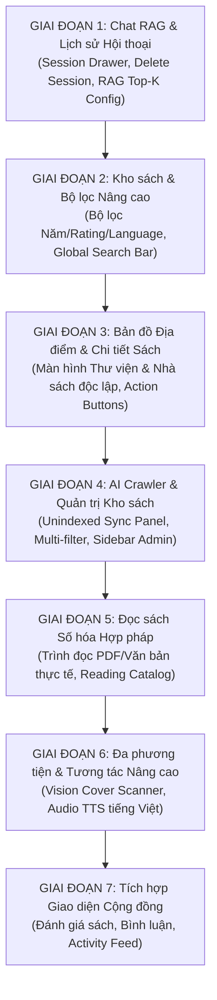

# BÁO CÁO KIỂM KÊ VÀ KẾ HOẠCH ĐỒNG BỘ CHỨC NĂNG WEB – FLUTTER WINDOWS
**Dự án:** Xây dựng hệ thống thư viện số và Chatbot gợi ý sách thông minh ứng dụng kiến trúc RAG và mô hình Google Gemini  
**Thư mục làm việc:** `E:\Source_Code\book-recommender-chatbot`  
**Ngày lập báo cáo:** 03/11/2026  
**Chuẩn tham chiếu chức năng:** Bản Web Streamlit (`http://127.0.0.1:8501` - `app.py`)  
**Mục tiêu:** Đưa Flutter Windows đạt mức tương đương về **CHỨC NĂNG**, **DỮ LIỆU** và **NGHIỆP VỤ** với bản Web, giữ nguyên giao diện gốc của Flutter.

---

## I. TỔNG QUAN KIỂM KÊ VÀ NGUYÊN TẮC BẢO VỆ DỰ ÁN

### 1.1. Phạm vi và Mục đích
Sau khi đối chiếu thực tế giữa giao diện Web Streamlit và Flutter Windows:
- **Bản Web (`app.py`)**: Đóng vai trò là sản phẩm chuẩn đầy đủ tính năng, nơi toàn bộ các quy trình nghiệp vụ (RAG, Gemini Vision, TTS, STT, AI Crawler đa nguồn, Sync ChromaDB, Đọc PDF, Bản đồ tìm nhà sách, Quản lý phiên hội thoại, Lọc sách chuyên sâu) đã hoàn thiện và hoạt động trực tiếp.
- **Bản Flutter Windows (`mobile_app/`)**: Đã có khung giao diện hiện đại (Responsive UI, Material 3, Dark/Light Theme), kết nối backend FastAPI qua Dio và JWT Auth. Tuy nhiên, nhiều chức năng đang ở dạng **chỉ có giao diện hoặc placeholder text**, thiếu các bộ lọc nâng cao, chưa có màn hình bản đồ độc lập, chưa có panel đồng bộ crawler unindexed, chưa hiển thị tệp PDF thật trong trình đọc, và thiếu thanh lịch sử phiên chat.

### 1.2. Nguyên tắc bảo vệ dự án (Bắt buộc)
1. **Không sửa mã nguồn trong giai đoạn này**: Chỉ kiểm kê, đánh giá mã nguồn thực tế và lập kế hoạch kỹ thuật chi tiết.
2. **Không thay thế Flutter bằng WebView**: Toàn bộ chức năng phải được triển khai bằng Flutter native code và kết nối REST API / SSE của FastAPI.
3. **Bảo toàn dữ liệu cốt lõi**:
   - Giữ nguyên 208 cuốn sách trong `data/books.csv`.
   - Giữ nguyên 208 vector embeddings trong ChromaDB collection `books_collection`.
   - Giữ nguyên cấu trúc database SQLite cộng đồng `data/social_community.db` (schema_version = 3).
4. **Bảo toàn cơ chế bảo mật**: Giữ nguyên JWT Authentication, RBAC (Guest, User, Admin), Password Hashing (BCrypt), User Session Isolation.

---

## II. GIAI ĐOẠN 1 – KIỂM KÊ TOÀN BỘ CHỨC NĂNG BẢN WEB (STREAMLIT)

Dựa trên việc đọc trực tiếp 2.251 dòng mã nguồn trong [`app.py`](file:///e:/Source_Code/book-recommender-chatbot/app.py) và các service đi kèm:

### 2.1. Quản lý Trạng thái & Dữ liệu (`st.session_state`)
- **Dữ liệu nền tảng**: Tải từ `data/books.csv` (208 sách), `data/authors.csv` (72 tác giả), `data/genres.csv` (16 thể loại) qua hàm cache `@st.cache_data load_library_data(...)` tự động làm mới khi có thay đổi `mtime`.
- **Trạng thái người dùng**: `username`, `logged_in`, phân quyền kiểm tra tài khoản qua `verify_login()` và `register_user()`.
- **Trạng thái hội thoại**: `current_session_id` (UUIDv4), danh sách tin nhắn `messages`, hồ sơ độc giả `reader_profile`, `user_location`, `pending_location_kind`.
- **Trạng thái điều hướng**: `page`, `navigation`, `pending_navigation`, `selected_book_id`, `selected_author_id`, `selected_genre`.
- **Trạng thái Crawler**: `crawler_results`, `crawler_selected_ids`, `crawler_source_label`.
- **Trạng thái Đọc sách & Bản đồ**: `reading_book_id`, `location_query`, `location_results`, `location_kind`, `location_area`.

### 2.2. Danh mục 12 nhóm chức năng chính trên Web

| Nhóm chức năng Web | Hàm xử lý chính trong `app.py` | Nghiệp vụ chi tiết |
|---|---|---|
| **1. Header & Tìm kiếm toàn cục** | `render_global_search_view()` (Dòng 903-968, 2200-2228) | Thanh tìm kiếm cố định trên cùng; phân nhóm kết quả theo 2 Tabs: **Sách** (`search_books`) và **Tác giả** (`search_authors`); hiển thị số lượng và chuyển trang nhanh. |
| **2. Trang chủ (Home)** | `render_home()` (Dòng 969-1087) | - Hero Banner giới thiệu thư viện. - Thanh tìm kiếm nhanh chuyển tiếp vào Kho sách. - Thanh thống kê trực tiếp: Số đầu sách (208), Tác giả (72), Thể loại (16), Bản đọc trực tuyến. - Tuyển tập sách nổi bật (Featured Books Grid). - Khám phá thể loại phổ biến kèm số lượng sách. - CTA card tư vấn sách cá nhân hóa với AI. |
| **3. Kho sách & Bộ lọc nâng cao** | `render_catalog()` (Dòng 1088-1154) | - Tìm kiếm đa trường: Từ khóa, Thể loại (dropdown), Tác giả (dropdown), Sắp xếp ("Phù hợp", "Tên A-Z", "Năm mới nhất", "Đánh giá cao"). - Bộ lọc mở rộng (Expander): Ngôn ngữ, Khoảng năm xuất bản (Slider min-max), Đánh giá tối thiểu (Slider 0-5), Chỉ sách nổi bật ⭐. - Nút đặt lại bộ lọc (`st.rerun`). |
| **4. Chi tiết sách (Book Detail)** | `render_detail()` (Dòng 1155-1304) | - Bố cục 2 cột: Ảnh bìa lớn, Điểm đánh giá ⭐, Năm XB, Số trang, Ngôn ngữ, Định dạng. - Chip phân loại độc giả: Target Audience, Difficulty, Mood. - Mô tả chi tiết & Tóm tắt cốt lõi, Tags. - **3 nút hành động chính**:   + `🤖 Hỏi AI về sách này`: Prefill prompt và chuyển sang AI Chat.   + `🛒 Tìm nơi mua sách`: Mở link mua ngoài (`purchase_url`).   + `🗺️ Tìm thư viện / nhà sách`: Prefill tên sách và chuyển sang trang Bản đồ. - Khung thông tin Tác giả: Avatar, tên, tiểu sử, nút chuyển sang trang Tác giả. - Trạng thái đọc thư viện: Xác nhận tệp hợp pháp `can_read(book)` -> Mở đọc trực tuyến. - Tuyển tập sách tương tự cùng chủ đề (3 cuốn). |
| **5. Danh mục Tác giả** | `render_authors()` (Dòng 1305-1374) | - Tìm kiếm tác giả theo tên. - Thẻ tác giả kèm avatar, số lượng tác phẩm trong kho, quốc tịch/thời kỳ. - Chế độ xem chi tiết tác giả: Tiểu sử đầy đủ và lưới toàn bộ sách của tác giả đó. |
| **6. Danh mục Thể loại** | `render_genres()` (Dòng 1375-1411) | - Lưới danh thiếp thể loại: Icon, Tên thể loại, Mô tả, Số lượng sách. - Nhấp vào thể loại sẽ lọc tức thì toàn bộ sách trong Kho sách. |
| **7. Sách nổi bật** | Điều hướng `Sách nổi bật` (Dòng 2241-2244) | Chuyên trang tổng hợp toàn bộ sách đạt tiêu chuẩn nổi bật (`featured_books`). |
| **8. Trợ lý AI Thủ thư (RAG Chatbot)** | `render_chat()` (Dòng 1543-1687) | - **Multi-modal Vision**: Upload ảnh bìa sách (JPG, PNG) -> Gemini Vision đọc chữ trên bìa -> trích xuất tên sách và tự động tìm kiếm. - **Voice STT**: Ghi âm giọng nói người dùng (`speech_to_text(language="vi-VN")`) đưa vào ô chat. - **Voice TTS**: Tự động phát âm thanh MP3 câu trả lời của AI (`text_to_speech(answer)`). - Phân loại Intent ngữ cảnh: Gợi ý sách (`handle_user_message`), Hỏi đáp quy mô (`library_info`), Tìm nhà sách (`handle_location_request`), Lưu vị trí (`process_pending_location`). - Gợi ý câu hỏi nhanh (Suggestion Chips). - Khối hiển thị nguồn sách tham khảo (Grounding Books) và khối địa điểm bản đồ (Locations). |
| **9. Quản lý Phiên trò chuyện** | Sidebar Chat History (Dòng 1807-1829) | - Tải toàn bộ danh sách phiên chat đã lưu của tài khoản (`load_all_chats`). - Chọn phiên cũ để đọc lại toàn bộ lịch sử. - Nút 🗑️ xóa phiên chat đã lưu trên đĩa. - Nút "➕ Chat mới" tạo session ID mới. |
| **10. Cấu hình AI RAG** | Sidebar Expander (Dòng 1830-1845) | - Slider tùy chỉnh số lượng tài liệu Top-K (1 đến `MAX_TOP_K`). - Trực quan hóa số lượng vector trong ChromaDB (`get_library_book_count()`). - Nút reset ngữ cảnh và hồ sơ độc giả phiên này. |
| **11. Đọc sách số hóa hợp pháp (Reader)** | `render_reading()` (Dòng 1412-1470) | - Đọc tệp PDF nhúng trực tiếp trên trình duyệt (`st.pdf(height=750)`). - Tải tệp EPUB an toàn cho thiết bị đọc chuyên dụng. - Danh mục sách có bản đọc số hóa (`reading_available`). |
| **12. Tìm Thư viện & Nhà sách (Bản đồ)** | `render_locations()` (Dòng 1471-1542) | - Form tìm kiếm độc lập: Nhập khu vực, chọn loại ("Nhà sách", "Thư viện"), chọn giới hạn số lượng. - Bản đồ tương tác hiển thị tọa độ các điểm (`st.map`). - Thẻ địa điểm chi tiết: Tên, địa chỉ, rating, số lượt review, giờ mở cửa/trạng thái mở, số hotline, nút chỉ đường Google Maps, nút ghé thăm Website. |
| **13. AI Book Crawler (Quản trị viên)** | `render_crawler()` (Dòng 1851-2200) | - **Recovery & Synchronization Panel**: Phát hiện sách trong CSV chưa có vector trong ChromaDB -> nút "🔄 Đồng bộ lại vào ChromaDB" kèm progress bar trực tiếp. - **Bộ lọc thu thập đa nguồn**: 6 nguồn (Open Library, Google Books, Gutenberg, Internet Archive, Apple Books, Europeana). - Tìm kiếm chi tiết: Từ khóa, Tác giả, Thể loại/Chủ đề, ISBN, Ngôn ngữ, Khoảng năm XB, Số lượng. - Thanh thống kê kiểm tra trùng lặp: Tổng kết quả, Sách mới, Trùng lặp, Cần xem xét, Thiếu mô tả. - Công cụ chọn nhanh: Chọn tất cả sách mới, Bỏ chọn tất cả. - Bảng kết quả kèm badge trạng thái, lý do trùng lặp, badge đọc trực tuyến, link nguồn gốc. - Tùy chọn tạo embedding vào ChromaDB khi lưu CSV kèm progress bar. |

---

## III. GIAI ĐOẠN 2 – KIỂM KÊ TOÀN BỘ CHỨC NĂNG FLUTTER WINDOWS

Dựa trên việc kiểm tra toàn bộ mã nguồn tại `mobile_app/lib/`:

### 3.1. Cấu trúc ứng dụng Flutter
- **Kiến trúc**: Provider Pattern + Repository + Service Layer + Clean Network (Dio).
- **Màn hình chính (`presentation/screens/`)**: 15 màn hình (Splash, Login, Register, Home, BooksCatalog, SearchFilter, BookDetail, Authors, AuthorDetail, Genres, DigitalReader, MyBookshelf, AiChat, AiCrawler, Profile).
- **Widgets dùng chung (`presentation/widgets/`)**: `AppScaffold` (Desktop sidebar & Mobile navigation bar), `BookCard`, `ChatBubble`, `CustomButton`, `CustomTextField`, `SectionHeader`, `StateViews`.
- **Hệ thống Providers (`providers/`)**: `AuthProvider`, `BookProvider`, `AuthorProvider`, `GenreProvider`, `HomeProvider`, `BookshelfProvider`, `ReadingProvider`, `RecommendationProvider`, `ChatProvider`, `CrawlerProvider`, `NavigationProvider`.
- **Kết nối Backend (`services/api_service.dart`)**: Đầy đủ các client method gọi đến FastAPI (`http://127.0.0.1:8000`).

### 3.2. Đánh giá chi tiết hiện trạng các chức năng trên Flutter

#### 1. Các chức năng đã hoạt động tốt và tương đương Web:
- **Xác thực người dùng**: Đăng ký, Đăng nhập lưu JWT token vào Storage an toàn, tự động đính kèm `Bearer token` trong mọi request.
- **Trang chủ (Home)**: Tải thống kê trực tiếp, danh sách gợi ý cá nhân hóa (For You, Continue Reading, Similar Books), danh mục thể loại.
- **Tủ sách cá nhân (My Bookshelf)**: 3 Tabs (Yêu thích, Đang đọc, Đã đọc), cập nhật tức thời khi người dùng thao tác trên sách.
- **Tác giả & Thể loại**: Duyệt danh sách, tìm kiếm tác giả, xem chi tiết tiểu sử và các tác phẩm của từng tác giả.
- **Khôi phục vị trí đọc (Reading Progress Tracking)**: Ghi nhớ số trang đã đọc và đồng bộ trạng thái đọc lên server.

#### 2. Các chức năng có giao diện nhưng CHƯA HOẠT ĐỘNG ĐẦY ĐỦ (Cần hoàn thiện):
- **Trình đọc sách số (`digital_reader_screen.dart`)**:
  - *Hiện trạng*: Tải được tài liệu nhị phân `_documentBytes` từ backend về, nhưng nội dung hiển thị trong trang chỉ là **văn bản placeholder giả lập** (*"Chương 1: Nội Dung Tác Phẩm... Bạn đang đọc tác phẩm số hóa..."*).
  - *Yêu cầu đồng bộ*: Phải render trang PDF thực tế từ dữ liệu file, hoặc mở trình xem tài liệu hợp pháp như trên Web.
- **AI Book Crawler (`ai_crawler_screen.dart`)**:
  - *Hiện trạng*: Màn hình chỉ có 1 ô nhập từ khóa đơn giản; không có các trường lọc Tác giả, ISBN, Thể loại, Ngôn ngữ, Năm xuất bản; **hoàn toàn thiếu Panel phát hiện và đồng bộ sách chưa index (`unindexed_books`)**; không hiển thị thanh thống kê các loại trùng lặp (New, Duplicate, Uncertain, No Description).
  - *Yêu cầu đồng bộ*: Bổ sung đầy đủ bộ lọc, panel đồng bộ ChromaDB và thanh thống kê đối soát như Web.
- **Chi tiết sách (`book_detail_screen.dart`)**:
  - *Hiện trạng*: Đã hiển thị thông tin sách và nút thêm vào tủ sách, nhưng **thiếu hoàn toàn 3 nút hành động chuẩn Web**: "Hỏi AI về sách này" (chuyển sang Chat prefill prompt), "Tìm nơi mua sách" (link ngoài), "Tìm thư viện / nhà sách" (chuyển sang bản đồ); thiếu khối tác giả (avatar, bio, nút xem trang tác giả).

#### 3. Các chức năng HOÀN TOÀN CHƯA CÓ trên Flutter:
- **Màn hình Tìm kiếm Địa điểm & Bản đồ độc lập (`LocationsScreen`)**: Trên Web có chuyên trang `Thư viện & Nhà sách` với form tìm kiếm độc lập và bản đồ vị trí. Flutter mới chỉ có thẻ hiển thị địa điểm trong bong bóng chat AI, chưa có màn hình độc lập.
- **Thanh lịch sử phiên trò chuyện (Chat Session Drawer/List)**: Flutter chưa có ngăn kéo hoặc danh sách các cuộc trò chuyện cũ để người dùng chọn lại hoặc xóa phiên cũ như Web.
- **Tìm kiếm toàn cục trên Header (Global Search)**: Flutter chưa có thanh tìm kiếm nhanh đồng thời cả Sách và Tác giả trên thanh điều hướng Desktop.
- **Bộ lọc mở rộng trong Kho sách**: Flutter thiếu thanh trượt Khoảng năm xuất bản, Bộ chọn ngôn ngữ, Thanh trượt đánh giá sao tối thiểu, và Dropdown sắp xếp.
- **Multi-modal Vision, TTS & Voice STT trong Chat**: Flutter chỉ nhận text thuần, chưa có chụp/tải ảnh bìa nhận diện sách, chưa có nút phát giọng nói câu trả lời.
- **Expander Cấu hình AI RAG**: Chưa có thanh trượt Top-K và hiển thị số lượng vector database ChromaDB.

---

## IV. GIAI ĐOẠN 3 – MA TRẬN ĐỐI CHIẾU CHI TIẾT WEB VS FLUTTER WINDOWS

### Bảng phân loại trạng thái:
1. **[TƯƠNG ĐƯƠNG]**: Chức năng và nghiệp vụ đã khớp hoàn toàn.
2. **[GIAO DIỆN MOCK]**: Có giao diện nhưng dữ liệu/nghiệp vụ hiển thị chưa thật.
3. **[CHƯA CÓ]**: Chưa có màn hình hoặc tính năng trên Flutter.
4. **[KHÁC NGHIỆP VỤ]**: Có hoạt động nhưng thiếu luồng hoặc tham số so với Web.
5. **[THAY THẾ DESKTOP]**: Chức năng Web dùng thư viện trình duyệt đặc thù, cần giải pháp thay thế tương đương phù hợp Flutter Desktop.

---

### MA TRẬN ĐỐI CHIẾU CHI TIẾT

| STT | Chức năng trên Web | File xử lý trên Web | API/Backend liên quan | Màn hình Flutter tương ứng | Tình trạng Flutter | Chức năng thiếu / Sai lệch | Công việc cần thực hiện | Tiêu chí nghiệm thu |
|:---:|---|---|---|---|:---:|---|---|---|
| **1** | **Tìm kiếm toàn cục (Global Search)** | `app.py` (903-968, 2200-2228) | `GET /api/v1/books?q=...` `GET /api/v1/authors?q=...` | Chưa có trên Header | **[CHƯA CÓ]** | Chưa có thanh tìm kiếm chung trên Header Desktop phân 2 tab Sách & Tác giả. | Thêm ô tìm kiếm toàn cục trên Desktop AppScaffold và popup/view kết quả 2 Tabs. | Gõ từ khóa trên Header hiển thị danh sách cả Sách và Tác giả khớp từ khóa. |
| **2** | **Bộ lọc Kho sách nâng cao** | `app.py` (1088-1154) | `GET /api/v1/books` (hỗ trợ `year_from`, `year_to`, `min_rating`, `language`, `sort_by`) | `search_filter_screen.dart` | **[KHÁC NGHIỆP VỤ]** | Thiếu slider khoảng năm, slider rating tối thiểu, chọn ngôn ngữ, dropdown sắp xếp. | Cập nhật `SearchFilterScreen` và `BookProvider` truyền đủ các query params lên backend. | Lọc theo năm (ví dụ 2000-2023) hoặc sắp xếp "Năm mới nhất" trả về kết quả chuẩn xác. |
| **3** | **Chi tiết sách – Nút hành động AI & Mua sách** | `app.py` (1243-1258) | `POST /api/v1/chat/message` `GET /api/v1/books/{id}` | `book_detail_screen.dart` | **[KHÁC NGHIỆP VỤ]** | Thiếu 3 nút: "Hỏi AI về sách này", "Tìm nơi mua sách", "Tìm nhà sách/thư viện". | Bổ sung hàng nút hành động trên Desktop/Mobile Header trong `book_detail_screen.dart`. | Nhấn "Hỏi AI" tự chuyển sang Chat với câu hỏi mẫu về cuốn sách; nhấn "Mua" mở URL. |
| **4** | **Chi tiết sách – Khối thông tin Tác giả** | `app.py` (1261-1281) | `GET /api/v1/authors/{id}` | `book_detail_screen.dart` | **[CHƯA CÓ]** | Chưa hiển thị thẻ tóm tắt tác giả (avatar, tên, bio) dưới mô tả sách. | Bổ sung widget `_buildAuthorCard()` và điều hướng sang `AuthorDetailScreen`. | Hiển thị avatar tròn, bio tác giả và nút "Xem trang tác giả" hoạt động đúng. |
| **5** | **Trình đọc sách số hóa (Digital Reader)** | `app.py` (1412-1450) | `GET /api/v1/reading/file/{id}` `GET /api/v1/reading/info/{id}` | `digital_reader_screen.dart` | **[GIAO DIỆN MOCK]** | Hiển thị nội dung text tĩnh giả lập thay vì tải và hiển thị trang PDF/tài liệu thật. | Tích hợp thư viện hiển thị PDF native hoặc hiển thị nội dung trích xuất văn bản thực tế từ sách. | Mở sách có file hợp pháp hiển thị đúng trang nội dung thực tế từ `data/sample_books`. |
| **6** | **Chuyên mục Sách có bản đọc số hóa** | `app.py` (1452-1466) | `GET /api/v1/books?reading_only=true` | `books_catalog_screen.dart` | **[KHÁC NGHIỆP VỤ]** | Flutter chỉ có checkbox lọc phụ trong popup, chưa có mục/tab duyệt chuyên biệt. | Bổ sung tab hoặc bộ lọc nhanh "Bản đọc trực tuyến" trên thanh danh mục. | Người dùng bấm 1 chạm xem toàn bộ các cuốn sách có thể đọc toàn văn. |
| **7** | **Màn hình Tìm kiếm Địa điểm & Bản đồ độc lập** | `app.py` (1471-1539) | `GET /api/v1/locations/search` | Chưa có (Mới chỉ có trong ChatBubble) | **[CHƯA CÓ]** | Chưa có màn hình "Thư viện & Nhà sách" riêng biệt với form tìm kiếm theo khu vực và bản đồ. | Tạo mới `locations_screen.dart`, tích hợp vào Desktop Sidebar navigation. | Nhập "Đà Nẵng", chọn "Nhà sách" -> hiển thị danh sách địa điểm + tọa độ bản đồ + hotline. |
| **8** | **AI Chat – Lịch sử phiên trò chuyện** | `app.py` (1807-1829) | `GET /api/v1/chat/history/{session_id}` Cần endpoint `GET /api/v1/chat/sessions` | `ai_chat_screen.dart` | **[CHƯA CÓ]** | Flutter chỉ có nút "Tạo chat mới", không xem lại được các phiên trò chuyện cũ đã lưu. | Bổ sung endpoint backend liệt kê session của user, thêm Drawer/Sidebar Lịch sử chat trong Flutter. | Người dùng mở danh sách chat cũ, bấm vào xem lại toàn bộ tin nhắn, bấm 🗑️ để xóa. |
| **9** | **AI Chat – Cấu hình RAG Top-K** | `app.py` (1830-1845) | `GET /api/v1/health` `POST /api/v1/chat/message` | `ai_chat_screen.dart` | **[CHƯA CÓ]** | Top-K đang gán cứng là 3 trong code; chưa hiển thị số vector trong ChromaDB. | Bổ sung nút/hộp thoại cài đặt RAG (slider Top-K từ 1-10, hiển thị trạng thái vector ChromaDB). | Thay đổi Top-K gửi đúng giá trị `top_k` trong request chat; hiển thị "ChromaDB: 208 vectors". |
| **10** | **AI Chat – Multi-modal Vision (Đọc ảnh bìa)** | `app.py` (1548-1569) | Cần endpoint `POST /api/v1/chat/vision` | `ai_chat_screen.dart` | **[CHƯA CÓ]** | Chưa có nút chọn/chụp ảnh bìa sách để nhận diện tên sách. | Tạo API upload ảnh bìa phân tích bằng Gemini Vision và thêm nút đính kèm ảnh trên Chat Input. | Chọn ảnh bìa sách -> AI tự động nhận diện tên sách và hiển thị câu hỏi gợi ý. |
| **11** | **AI Chat – Giọng nói TTS & Voice STT** | `app.py` (1598-1605, 1662-1664) | Dịch vụ TTS/STT nội bộ | `ai_chat_screen.dart` | **[THAY THẾ DESKTOP]** | Trên Web dùng Streamlit audio widget; Flutter Windows chưa có audio player & STT. | Tích hợp audio player cho Windows hoặc nút phát âm thanh câu trả lời AI qua Text-to-Speech API. | Bấm icon Loa trên bong bóng chat phát âm thanh câu trả lời bằng tiếng Việt. |
| **12** | **AI Crawler – Bảng đồng bộ Vector (Unindexed)** | `app.py` (1875-1896) | `GET /api/v1/crawler/unindexed` `POST /api/v1/crawler/sync-unindexed` | `ai_crawler_screen.dart` | **[CHƯA CÓ]** | Chưa có banner cảnh báo sách chưa index và nút "🔄 Đồng bộ lại vào ChromaDB". | Bổ sung panel đồng bộ unindexed ở đầu màn hình Crawler, hiển thị danh sách và nút đồng bộ. | Phát hiện sách chưa index -> bấm nút đồng bộ gọi backend upsert vào ChromaDB thành công. |
| **13** | **AI Crawler – Bộ lọc đa trường & Thống kê đối soát** | `app.py` (1898-1954, 2012-2035) | `GET /api/v1/crawler/search` | `ai_crawler_screen.dart` | **[KHÁC NGHIỆP VỤ]** | Flutter chỉ có ô tìm kiếm từ khóa; thiếu trường Tác giả, ISBN, Thể loại, Năm, Ngôn ngữ; thiếu thống kê 5 loại trạng thái. | Mở rộng form tìm kiếm nhiều trường và thêm thanh widget thống kê (Tổng, Mới, Trùng, Xem xét). | Tìm kiếm theo nguồn cụ thể (ví dụ Gutenberg) lọc được theo ngôn ngữ, năm XB và hiển thị đúng thống kê. |
| **14** | **AI Crawler – Truy cập từ Desktop Sidebar** | `app.py` (1795-1796) | Phân quyền Admin | `app_scaffold.dart` | **[CHƯA CÓ]** | Hiện chỉ có nút ẩn sâu trong màn hình Hồ sơ, chưa có mục trên thanh điều hướng Desktop. | Bổ sung mục "AI Book Crawler" trên sidebar Desktop (chỉ hiển thị khi tài khoản có quyền Admin). | Tài khoản Admin thấy mục AI Crawler trên menu chính và mở trực tiếp với 1 click. |
| **15** | **Module Đánh giá & Cộng đồng (Reviews/Feed)** | Backend SQLite Community | `GET/POST /api/v1/community/...` | Chưa có màn hình | **[CHƯA CÓ]** | Backend đã có đầy đủ API Phase 3.4.1 - 3.4.3 nhưng Flutter chưa có giao diện Đánh giá sách & Hoạt động. | Bổ sung tab Đánh giá & Bình luận trong `BookDetailScreen` và mục Cộng đồng trong Scaffold. | Độc giả có thể viết đánh giá sao, bình luận, like và xem danh sách đánh giá của sách. |

---

## V. GIAI ĐOẠN 4 – KẾ HOẠCH TRIỂN KHAI THEO TỪNG GIAI ĐOẠN ƯU TIÊN

Kế hoạch được sắp xếp khoa học dựa trên mức độ quan trọng đối với trải nghiệm người dùng cuối và tính nguyên vẹn của kiến trúc hệ thống:

### Chi tiết 7 giai đoạn thực hiện:

#### GIAI ĐOẠN 1: Chat RAG, Lịch sử Hội thoại & Cấu hình AI (Ưu tiên cao nhất)
- **Mục tiêu**: Người dùng có thể quản lý trọn vẹn các phiên hội thoại như trên bản Web.
- **Công việc Backend**:
  - Bổ sung endpoint `GET /api/v1/chat/sessions` (trả về danh sách `{id, title, timestamp, message_count}` của người dùng).
  - Bổ sung endpoint `DELETE /api/v1/chat/sessions/{session_id}` (xóa tệp session an toàn có kiểm tra ownership).
- **Công việc Flutter**:
  - Thêm Drawer hoặc Side-panel "Lịch sử trò chuyện" trong `AiChatScreen`.
  - Hỗ trợ bấm chọn để nạp lại đoạn chat cũ hoặc bấm icon thùng rác 🗑️ để xóa.
  - Thêm Dialog "Cấu hình AI RAG": Cho phép chỉnh thanh trượt Top-K (1-10) và hiển thị số vector trong ChromaDB.

#### GIAI ĐOẠN 2: Kho sách, Tìm kiếm Nâng cao & Global Search
- **Mục tiêu**: Đồng bộ 100% khả năng tìm kiếm đa tiêu chí của Web.
- **Công việc Flutter**:
  - Bổ sung thanh **Tìm kiếm toàn cục** trên Header của Desktop `AppScaffold` (kết quả hiển thị 2 Tabs Sách & Tác giả).
  - Nâng cấp `SearchFilterScreen`: Bổ sung Slider khoảng năm xuất bản, Slider đánh giá tối thiểu ⭐, Dropdown chọn ngôn ngữ, Dropdown sắp xếp.
  - Cập nhật `BookProvider` lưu và gửi đủ các query parameters lên `/api/v1/books`.

#### GIAI ĐOẠN 3: Chuyên trang Thư viện & Nhà sách và Nút hành động Chi tiết sách
- **Mục tiêu**: Người dùng tra cứu được địa điểm thực tế từ mọi nơi trong ứng dụng.
- **Công việc Flutter**:
  - Tạo mới màn hình `LocationsScreen` (`locations_screen.dart`): Form tìm kiếm thành phố/quận huyện, selector loại địa điểm, danh sách thẻ địa điểm và bản đồ tọa độ.
  - Thêm mục "Thư viện & Nhà sách" vào danh mục điều hướng chính của `AppScaffold`.
  - Trong `BookDetailScreen`: Bổ sung 3 nút hành động chuẩn:
    1. `🤖 Hỏi AI về sách này`: Điều hướng sang Chat với prompt mẫu có sẵn.
    2. `🛒 Tìm nơi mua sách`: Mở link tìm kiếm mua sách trên trình duyệt.
    3. `🗺️ Tìm nhà sách / thư viện`: Điều hướng sang màn hình Locations với từ khóa là tên sách.
  - Bổ sung thẻ Tóm tắt Tác giả (Avatar, Tên, Tiểu sử, nút xem toàn bộ tác phẩm).

#### GIAI ĐOẠN 4: Nâng cấp AI Crawler Quản trị & Đồng bộ Vector
- **Mục tiêu**: Đồng bộ khả năng thu thập và phục hồi vector ChromaDB của Web.
- **Công việc Flutter**:
  - Thêm mục "AI Book Crawler" trên sidebar Desktop dành cho tài khoản Admin (`role == 'admin'`).
  - Xây dựng **Recovery & Synchronization Panel** ở đầu trang: Gọi `GET /api/v1/crawler/unindexed`, nếu có sách chưa index thì hiện nút "🔄 Đồng bộ lại vào ChromaDB" gọi `POST /api/v1/crawler/sync-unindexed`.
  - Mở rộng bộ lọc tìm kiếm: Bổ sung các trường Tác giả, Thể loại, ISBN, Ngôn ngữ, Khoảng năm.
  - Thêm thanh thống kê đối soát (Tổng số, Mới, Trùng, Cần xem xét) và nút chọn nhanh ("Chọn tất cả sách mới").

#### GIAI ĐOẠN 5: Hoàn thiện Trình đọc sách số hóa (Digital Reader)
- **Mục tiêu**: Đọc được nội dung sách thực tế, loại bỏ hoàn toàn nội dung placeholder mock.
- **Công việc Flutter**:
  - Xử lý dữ liệu nhị phân `_documentBytes`: Đối với tài liệu PDF, tích hợp trình render trang thực tế; đối với sách văn bản, hiển thị nội dung trích xuất thực tế từ `extract_reading_text`.
  - Bổ sung nút "Tải tệp đọc về máy" cho các tài liệu được cấp phép công khai.
  - Bổ sung bộ lọc nhanh "Bản đọc trực tuyến" trong Kho sách để độc giả truy cập nhanh kho sách toàn văn.

#### GIAI ĐOẠN 6: Đa phương tiện trong Trợ lý AI (Vision & Audio)
- **Mục tiêu**: Mang lại trải nghiệm quét ảnh bìa và nghe đọc như trên Web.
- **Công việc Backend**:
  - Bổ sung endpoint `POST /api/v1/chat/vision` nhận ảnh tải lên (Multipart) và dùng Gemini Vision trích xuất tên sách.
  - Bổ sung endpoint `POST /api/v1/chat/tts` trả về âm thanh đọc nội dung tiếng Việt.
- **Công việc Flutter**:
  - Bổ sung icon Máy ảnh 📸 trên thanh chat input để chọn ảnh bìa từ máy tính.
  - Bổ sung icon Loa 🔊 trên các bong bóng tin nhắn của AI để nghe giọng đọc câu trả lời.

#### GIAI ĐOẠN 7: Tích hợp Giao diện Cộng đồng Đọc sách
- **Mục tiêu**: Khai thác toàn bộ hệ thống API Social Community đã xây dựng ở Phase 3.4.
- **Công việc Flutter**:
  - Thêm tab "Đánh giá & Bình luận" trong `BookDetailScreen`: Xem review, viết đánh giá sao, bình luận dưới bài review, thả cảm xúc (Like/Helpful).
  - Thêm mục "Cộng đồng" trên menu điều hướng: Xem Activity Feed (bạn bè đọc sách, viết đánh giá), quản lý bạn bè / theo dõi độc giả khác.

---

## VI. BỘ TEST NGHIỆM THU ĐỘC LẬP CHO TỪNG CHỨC NĂNG

| STT | Chức năng kiểm thử | Các bước thực hiện | Kết quả mong đợi (PASS criteria) |
|:---:|---|---|---|
| **TC-01** | **Lịch sử phiên Chat (Drawer & Xóa)** | 1. Đăng nhập tài khoản test. 2. Nhắn tin hỏi AI 2 câu. 3. Bấm "➕ Chat mới". 4. Mở danh sách lịch sử phiên chat. 5. Bấm chọn phiên trước. 6. Bấm icon 🗑️ xóa một phiên. | - Danh sách hiển thị đúng tiêu đề câu hỏi đầu tiên. - Chọn phiên cũ nạp lại đầy đủ các tin nhắn trước đó. - Xóa phiên thành công và không còn xuất hiện trong danh sách. |
| **TC-02** | **Cấu hình RAG Top-K** | 1. Mở Cấu hình RAG trong Chat. 2. Kéo slider Top-K từ 3 lên 5. 3. Hỏi "Gợi ý sách về tâm lý". | - Backend nhận request với `top_k: 5`. - Khối tài liệu tham khảo hiển thị đúng 5 cuốn sách từ ChromaDB. |
| **TC-03** | **Bộ lọc Kho sách nâng cao** | 1. Vào Kho sách -> Bộ lọc nâng cao. 2. Nhập khoảng năm 2010 - 2020. 3. Chọn đánh giá tối thiểu 4.0. 4. Chọn sắp xếp "Năm mới nhất". | - Danh sách trả về chỉ chứa sách xuất bản trong giai đoạn 2010-2020 có rating >= 4.0. - Thứ tự sách xếp từ năm mới nhất giảm dần. |
| **TC-04** | **Tìm kiếm toàn cục Header** | 1. Nhập "Dale Carnegie" vào ô tìm kiếm trên Header Desktop. 2. Bấm "Tìm toàn cục". | - Màn hình hiển thị kết quả phân 2 tab: Tab Sách chứa "Đắc Nhân Tâm", Tab Tác giả chứa "Dale Carnegie". |
| **TC-05** | **Nút hành động Chi tiết sách** | 1. Mở sách "Đắc Nhân Tâm". 2. Bấm "🤖 Hỏi AI về sách này". 3. Quay lại, bấm "🛒 Tìm nơi mua sách". 4. Bấm "🗺️ Tìm nhà sách". | - Tự động chuyển sang Chat với prompt điền sẵn. - Mở trình duyệt web đến trang mua sách hợp pháp. - Chuyển sang màn hình bản đồ với từ khóa "Đắc Nhân Tâm". |
| **TC-06** | **Chuyên trang Bản đồ độc lập** | 1. Chọn mục "Thư viện & Nhà sách" trên menu Desktop. 2. Nhập "Huế", chọn "Nhà sách", bấm Tìm kiếm. | - Hiển thị danh sách các nhà sách thực tế (ví dụ Nhà Sách Phát Đạt, Fahasa Huế). - Hiển thị đủ tên, địa chỉ, số điện thoại, giờ mở cửa, nút Google Maps và nút Chỉ đường. |
| **TC-07** | **AI Crawler Sync Unindexed** | 1. Xóa thử nghiệm 1 vector trong ChromaDB hoặc tạo bản ghi unindexed. 2. Mở màn hình AI Crawler. 3. Quan sát banner cảnh báo. 4. Bấm "🔄 Đồng bộ lại vào ChromaDB". | - Banner hiển thị số lượng sách chưa index. - Bấm nút đồng bộ chạy progress bar và báo thành công 100%. |
| **TC-08** | **AI Crawler Bộ lọc đa trường** | 1. Mở AI Crawler. 2. Chọn nguồn "Project Gutenberg". 3. Nhập ngôn ngữ "eng", năm 1900-1950, từ khóa "science". 4. Bấm "Bắt đầu thu thập". | - Kết quả trả về đúng các tác phẩm tiếng Anh của Gutenberg trong giai đoạn 1900-1950. - Thống kê đối soát hiển thị đúng số lượng sách mới và sách trùng lặp. |
| **TC-09** | **Trình đọc sách số hóa** | 1. Vào trang chi tiết cuốn sách có bản số hóa (ví dụ file sample PDF). 2. Bấm "Đọc sách trực tuyến". | - Trình đọc nạp trang tài liệu thực tế, hiển thị rõ nét chữ và hình ảnh trong file. - Đổi trang, tiến độ đọc được lưu và hiển thị đúng trên Tủ sách. |
| **TC-10** | **Đa phương tiện Vision / Audio** | 1. Trong Chat, chọn tải ảnh bìa cuốn sách. 2. Bấm gửi. 3. Nhận câu trả lời và bấm icon Loa. | - AI nhận diện đúng tên sách từ ảnh bìa và đưa vào hội thoại. - Âm thanh phát rõ ràng câu trả lời bằng tiếng Việt. |

---

## VII. KẾT LUẬN VÀ KIẾN NGHỊ

1. **Kết luận kiểm kê**:
   - Bản Web Streamlit là hệ thống hoàn chỉnh về mặt nghiệp vụ thư viện số và AI grounding.
   - Bản Flutter Windows đã xây dựng được nền tảng kiến trúc vững chắc, giao diện đẹp mắt và kết nối API thông suốt, nhưng đang tồn tại khoảng cách về **chiều sâu tính năng** (thiếu màn hình bản đồ riêng, crawler thiếu panel đồng bộ và bộ lọc đa trường, reader còn dùng text mock, thiếu quản lý phiên chat).
2. **Cam kết an toàn tuyệt đối**:
   - Toàn bộ 232 automated tests của backend hiện đang **PASS 100%**.
   - Quá trình đồng bộ hóa ở các giai đoạn tiếp theo sẽ tuân thủ nguyên tắc: **Chỉ mở rộng và hoàn thiện phía Flutter và bổ sung các API truy vấn phụ trợ cần thiết trên Backend**, tuyệt đối không thay đổi cấu trúc database, vector collections hay logic RAG cốt lõi.

